<p align="right"><b>English</b> · <a href="README.ru.md">Русский</a></p>

<p align="center">
  
</p>

<h1 align="center">Remiqora</h1>
<p align="center"><i>Made with AI. Made by you.</i></p>

<p align="center">
  A local, GPU-powered music generation and production studio — one interface for <b>ACE-Step 1.5</b>, <b>YuE2-3B</b> and <b>Stable Audio 3</b>, with a built-in multitrack DAW, an <b>AI arranger</b> that writes new parts into your track, and <b>From an idea</b>: one phrase in, and a local language model writes the prompt.
</p>

<p align="center">🚧 Actively in development — expect breaking changes, bugs, and rough edges. Not a stable release yet.</p>

<p align="center">
  <a href="https://remiqora.com/"></a>
  
  <a href="LICENSE"></a>
  
  
  
  
  <a href="https://ko-fi.com/inikolax"></a>
</p>

<p align="center">
  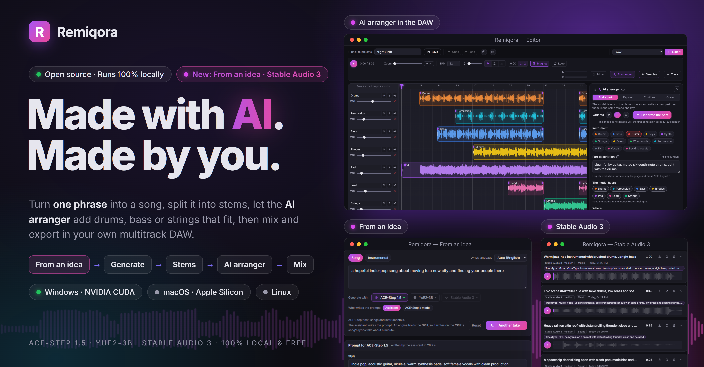
</p>

<p align="center">
  <a href="#why-this-exists">Why</a> ·
  <a href="#whats-inside">What's inside</a> ·
  <a href="#from-an-idea">From an idea</a> ·
  <a href="#languages">Languages</a> ·
  <a href="#ace-step-generation">ACE-Step</a> ·
  <a href="#yue2-and-sheetsage2-generation">YuE2</a> ·
  <a href="#stable-audio-3-generation">Stable Audio 3</a> ·
  <a href="#lora-training-ace-step">LoRA</a> ·
  <a href="#built-in-daw">DAW</a> ·
  <a href="#ai-arranger">AI arranger</a> ·
  <a href="#desktop-app-experimental">Desktop app</a> ·
  <a href="#built-with">Built with</a> ·
  <a href="#license--liability-for-generated-content">License</a> ·
  <a href="#-installation">Installation</a>
</p>

---

## Why this exists

ACE-Step and YuE2 are two independent music generation engines, each with its own web UI, its own result-storage format, and its own process that has to be started and stopped by hand. They typically cannot run simultaneously on a single consumer GPU. Remiqora solves this with a single layer on top:

- **One UI** instead of two different interfaces with different UX.
- **Mutually-exclusive orchestrator**: pick a model in the header — it starts up, and the other one stops on its own. No need to manually kill processes before starting the other engine.
- **Shared storage**: every track (generated, uploaded, or assembled in the editor) is tracked in a centralized SQLite database and shared folder, available from every module — Demucs, MuScriptor and the editor all work off the same library instead of three separate ones.
- **A DAW on top of generation**: a generated track isn't the end point, it's raw material — split it into stems, drag it onto a timeline, process it with effects, blend it with other tracks, and export.
- **An AI arranger inside the DAW**: instead of re-rolling a whole song, build it up part by part — the model listens to the lanes you pick and writes drums, bass, strings or a new section that fit their tempo and key, as variants on their own lanes.
- **From an idea**: describe a song in one phrase; a local language model writes the prompt in the chosen engine's own format (style tags, lyrics, tempo, key), you can edit it, and the engine makes the track.
- **Built-in LoRA training**: not just generation — fine-tune ACE-Step on your own voice or style right from the browser, no console needed.
- **Install only what you need**: the desktop installer lets you leave out YuE2, stem separation or the arranger's base models and add them later from the app; the header shows RAM and video memory and can unload the running model.

---

## What's inside

| Module | What it does |
|---|---|
| **ACE-Step 1.5** | Fast generation from text/style tags, covers, section repainting, extracting/adding parts on top of a reference track. |
| **YuE2-3B** | Full-length track generation with CoT score planning (a symbolic ABC plan before the audio). |
| **SheetSage2** | Extracts melody and harmony from a reference track into ABC notation — used as YuE2's input. |
| **Stable Audio 3** | Instrumentals and sound effects from a description in seconds (no vocals); in the editor's AI arranger it repaints, continues and covers by listening to the audio around the range. |
| **From an idea** | One phrase in, a track out: a local language model (Qwen3.5) writes the prompt for ACE-Step, YuE2 or Stable Audio 3, you edit it if you like, and the engine generates. |
| **LoRA training** | Dataset → auto-labeling → preprocessing → training → export — the whole ACE-Step fine-tuning pipeline for your own voice/style, in the browser. |
| **Demucs** | Splits any track into 4 stems: vocals, drums, bass, other. |
| **MuScriptor** | Transcribes audio (the full mix or a single stem) into MIDI notes. |
| **Built-in DAW** | A multitrack timeline editor for assembling tracks/stems into a final mix: an effects rack on every channel, auto-BPM and time-stretch, WAV/MP3 export, or stems with a Reaper project / DAWproject to finish in your own DAW. |
| **AI arranger** | Adds a part (drums, bass, strings, keys, vocals and more) on top of the lanes you choose, repaints a section, continues the track or covers it in another style — each variant lands on its own lane. |
| **Samples** | One-shots, loops at the project tempo and textures from a description (Stable Audio 3), auditioned in the editor and dropped onto a track. |

Remiqora's interface and installer come in 20 languages: see [Languages](#languages).

---

## From an idea


The first tab in the header. Describe a song or an instrumental in your own words, pick an engine, and a local language model, the prompt assistant, writes the prompt in that engine's own format:

- **ACE-Step**: a style caption, lyrics, tempo, key and length. While the engine runs, ACE-Step's own language model can write it instead: faster, but it strays further from the idea.
- **YuE2** (songs): the song's language as the first tag (`Russian`, `English`...), then 5–9 style tags in English, and lyrics split into sections, in the language of the idea or the one you pick.
- **Stable Audio 3** (instrumentals and sounds): Stable Audio's own classifier first decides whether the idea is music or a sound ("rain on a window" is a sound, not a song), then the prompt is written with its instructions for that kind; a *Music / Sound* switch fixes a wrong guess, and a sound gets the `small-sfx` checkpoint when it is downloaded.

While the prompt is written, the page shows the stage, an estimated percent, the text as it grows and a *Stop* button. The prompt then opens as editable fields. *Generate* starts the engine if needed and sends the job; the track is named after the idea and lands in the engine's feed. *Open in the form* puts the prompt into the engine's own page for the settings this page leaves out, and the form takes it as soon as the engine has started. The idea and the prompt stay when you leave the page and after a reload.

The assistant is Qwen3.5 (0.8B, 2B by default, or 4B; Apache-2.0), downloaded and set up on the Models page. On *auto* it writes on the GPU while no engine runs and on the CPU otherwise: a song's lyrics take about 10 s on the GPU and up to a minute on the CPU. On *GPU* it unloads the running engine to write, and *Generate* swaps the engine back. It starts with the first request and stops after a set idle time.

---

## Languages

**Remiqora speaks 20 languages**: the interface, the help and guides, and the first-run installer. It starts in your system language (the switcher in the header overrides it) and loads a language only when you pick it.

| | |
|---|---|
| **Hand-written** | Русский · English |
| **Europe** | Español · Português (Brasil) · Deutsch · Français · Italiano · Polski · Українська · Türkçe |
| **Asia** | Қазақша · 简体中文 · 繁體中文 · 日本語 · 한국어 · Tiếng Việt · Bahasa Indonesia · हिन्दी |
| **Right-to-left** | العربية · فارسی · עברית |

> **Every language except Russian and English is a machine translation.** A large language model translated 1,831 interface strings and 140 installer strings per language; scripts checked that every key and placeholder matches the English text. No native speaker has read them, so expect clumsy phrasing and wrong terms, most of all in the rarer languages. Traditional Chinese is converted from Simplified with OpenCC. Corrections are welcome.

Arabic, Persian and Hebrew mirror the whole layout. The timeline, waveform and mixer stay left-to-right on purpose: time and signal flow do not mirror.

### Ideas and songs in any language

- **From an idea** works in all 20 languages and in the 51 vocal languages of the *Lyrics language* list. The language of your idea is recognised from its alphabet, its special letters and its most frequent words (checked on 65 texts in 20 languages with no misses); when it is ambiguous, pick the language by hand.
- **Kazakh** is not on ACE-Step's own list, so it was tested: with the `kk` tag ACE-Step sings it as well as with `ru` (average error 0.45 against 0.43 over nine seeds each), so `kk` is sent as it is.
- **Quality follows the model.** The default assistant (Qwen3.5-2B) writes in the requested language every time, but its verse in Kazakh or Hindi is clumsy; the 4B model on the Models page does noticeably better.

### What was tested (October 2026)

**The prompt assistant.** An idea written in each of the 20 languages was sent to the assistant twice, for a YuE2 song and for an ACE-Step song. A language detector confirmed that the lyrics came back in the requested language in every reply (it called Indonesian "Malay"; the text is Indonesian). About 7 % of requests (3 of 40) first failed on invalid JSON from the small model, in English as well, so the assistant now tries three times instead of two; 24 repeat runs were clean.

**Real songs.** One short song with the same four-line text, translated into each language, was generated in **ACE-Step** (48 s) and in **YuE2** (22-51 s), the vocal was separated with Demucs, and **Whisper large-v3** transcribed it. The table shows how much of the reference text was found in the transcript.

<details>
<summary><b>Share of the lyrics Whisper found in each song</b></summary>

| Language | ACE-Step | YuE2 |
|---|--:|--:|
| English | 70 % | 100 % |
| Русский | 56 % | 99 % |
| Español | 71 % | 100 % |
| Português | 82 % | 98 % |
| Deutsch | 76 % | 100 % |
| Français | 78 % | 100 % |
| Italiano | 92 % | 100 % |
| Polski | 79 % | 100 % |
| Українська | 91 % | 89 % |
| Türkçe | 10 % | 96 % |
| 中文 | 0 % | 94 % |
| 日本語 | 14 % | 95 % |
| 한국어 | 48 % | 93 % |
| Tiếng Việt | 44 % | 27 % |
| Bahasa Indonesia | 18 % | 100 % |
| हिन्दी | 64 % | 91 % |
| العربية | 20 % | 67 % |
| فارسی | 70 % | 84 % |
| עברית | 10 % | 97 % |
| Қазақша | 83 % | 79 % |
| **average** | **54 %** | **90 %** |

Read it as a direction, not a verdict: one song per language and engine, Whisper itself is unreliable on singing, and a low ACE-Step figure (Chinese, Japanese, Turkish, Hebrew) means "not recognised in this sample", not "unsupported": in short clips the vocal often starts late. YuE2 sang the text in almost every language, including ones its authors do not list; its extra "hey, oh" fills were not counted against it.

</details>

The test songs are not part of the repository.

---

## ACE-Step: generation

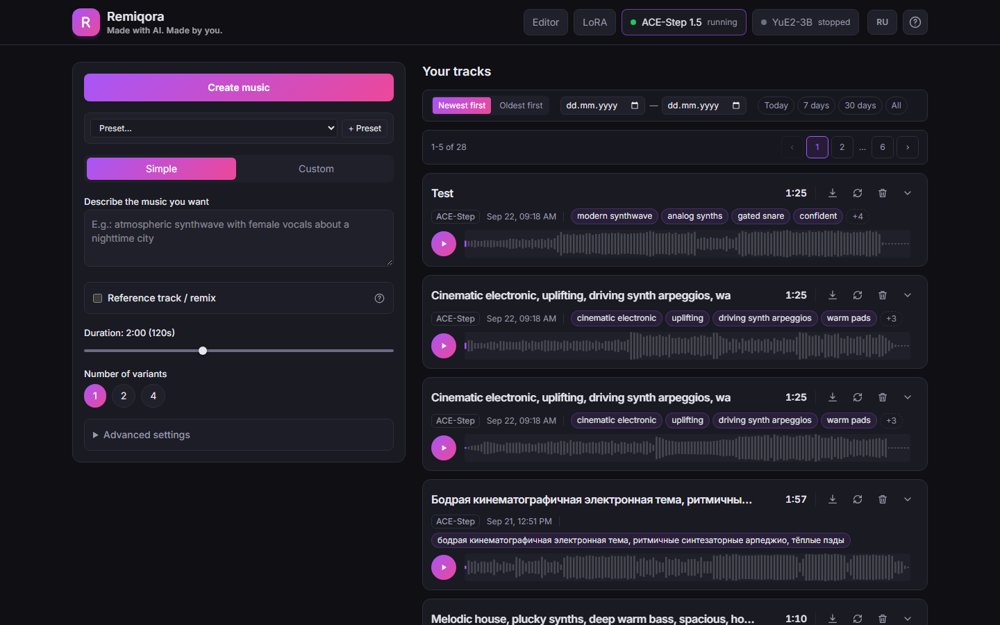

Two input modes: **“Simple”** — a single text description the model uses to infer both style and lyrics on its own; and **“Custom”** — style tags with autocomplete plus lyrics with structure markup (`[Verse]/[Chorus]/[Bridge]`) and performance annotations (`(whisper)`, `(falsetto)`), or an “Instrumental” checkbox.

Attaching a reference track unlocks 5 remix scenarios:
- **Cover** — restyle while keeping the melody (tunable original-preservation strength).
- **Repaint a section** — replace only a chosen part of the track.
- **Extract a part** — pull one instrument/voice out of a finished mix (12 options: vocals, drums, bass, guitar, etc.).
- **Add a part** — compose one missing instrument on top of the mix.
- **Finish the composition** — the same, but for a whole list of parts at once.

Plus: 10–300 s duration, batch of 1/2/4 variants, mp3/wav/flac formats, advanced parameters (BPM, key, time signature, vocal language — guessed from the lyrics by default, inference steps, guidance scale, seed), LoRA adapter support with adjustable strength, local presets, and a "Stop all" button for bulk job cancellation.

## YuE2 and SheetSage2: generation

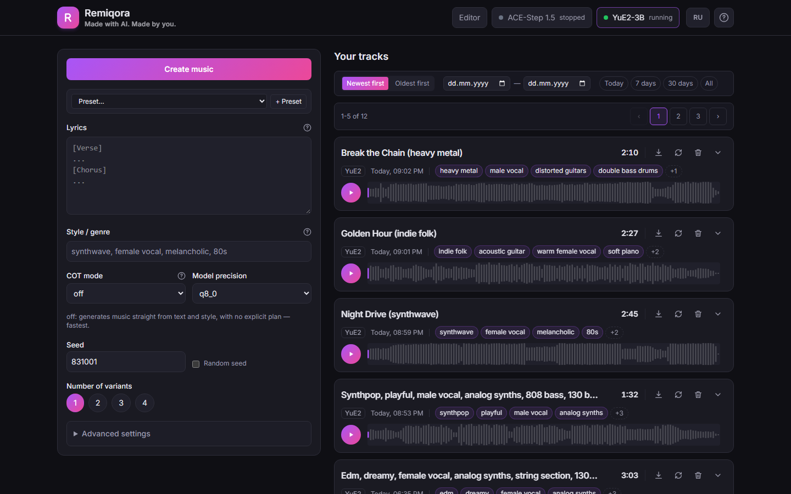

Three **CoT (Chain-of-Thought)** modes: `off` — straight to audio; `melody` — the arrangement is built around a given melody (ABC); `full` — the model first builds a symbolic plan (melody + chords), then generates the audio.

**SheetSage2** lets you upload a reference track and pull its melody into ABC notation, right in the form, with one click — editable by hand afterwards. Beyond that: `q8_0`/`q4_0` precision, batch of 1–4, a full set of sampling parameters for audio generation and the ABC planner separately, local presets, and viewing/reusing the ABC score of an already-generated track.

## Stable Audio 3: generation


Instrumentals and sound effects from a description, in seconds; no vocals. Pick **Music** or **Sound**, describe it in English (genre, instruments, mood and tempo; for a sound its source, how it happens and the room), set the length (up to 6 minutes on `medium`, 2 on the small checkpoints) and 1, 2 or 4 variants. A **reference track** turns the same form into a cover (audio-to-audio with a closeness slider), a repaint of one or more ranges, or a continuation. Six checkpoints are downloaded from the Models page; the page says how many are there. More on the page's options under [Samples](#samples).

## LoRA training (ACE-Step)

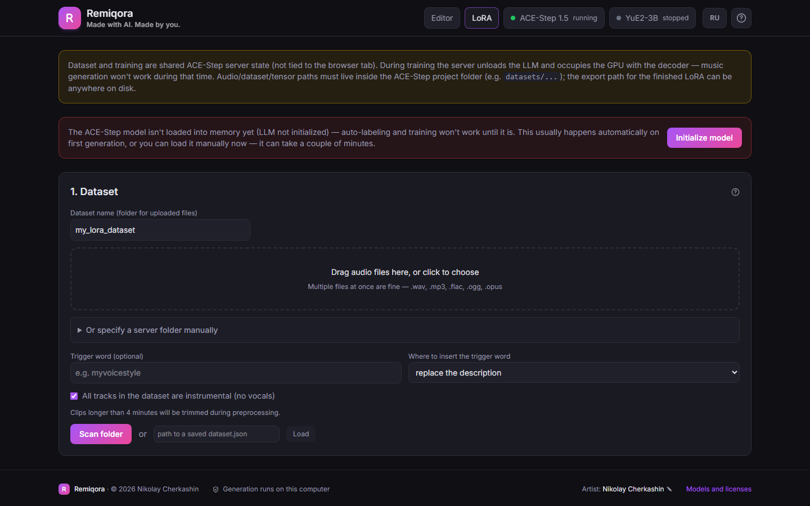

The full ACE-Step fine-tuning pipeline on your own dataset, no console required. It is a tab on ACE-Step's page, next to *Generate*:

1. **Dataset** — upload audio files straight from the browser (drag & drop) or point at an existing server folder, a trigger word, an "all tracks are instrumental" flag.
2. **Automatic labeling** — LLM-generated description, genre, BPM/key, lyrics transcription/reformatting.
3. **Review and edit** — a table of every sample where you can fix the description/genre/tags before training.
4. **Preprocessing** — converts labeled samples into tensors.
5. **Training** — LoRA rank/alpha/dropout, learning rate, epochs, batch size, FP8, gradient checkpointing, live progress with an ETA and a TensorBoard link.
6. **Export and registry** — the finished adapter is immediately added to the LoRA list on the generation form.

## Stem separation (Demucs)

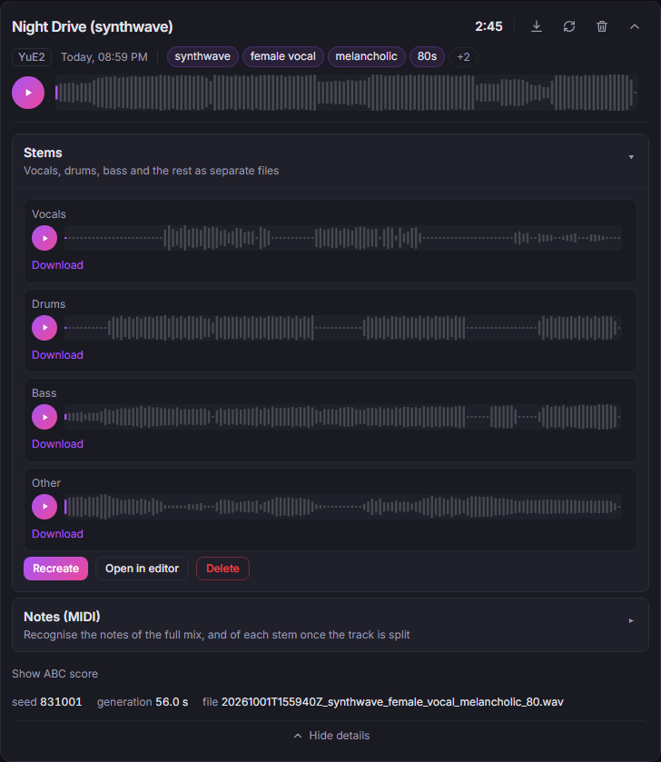

One click splits any saved track into 4 isolated stems (Demucs `htdemucs`), with a progress bar, a separate player and download per stem, and the option to redo or delete. Runs alongside the active generation model (without stopping it), sharing a GPU lock. The **"Open in editor"** button allows you to instantly send all 4 stems into a new built-in DAW project for further mixdown.

## MIDI transcription (MuScriptor)

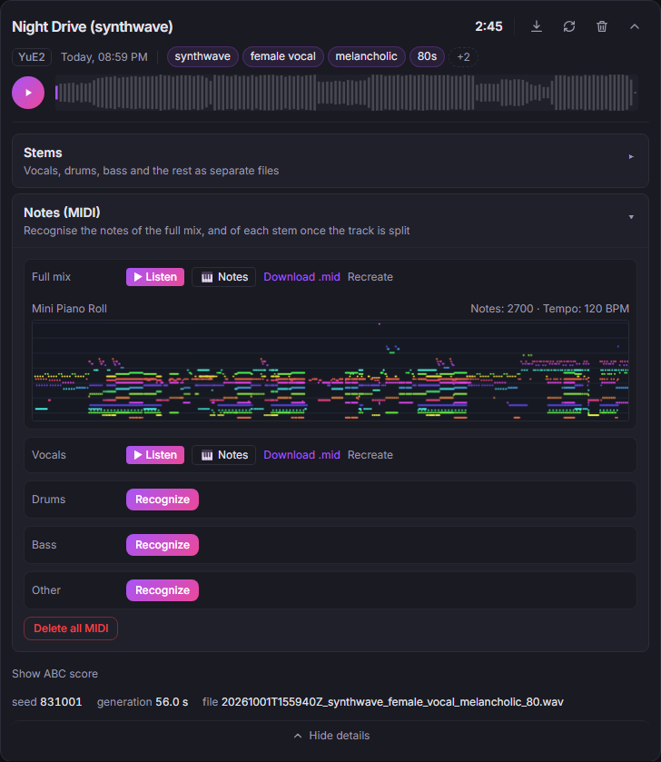

Transcribes the full mix, or any already-separated stem, into MIDI. Technically this isn't a separate process — it's a model loaded into the already-running YuE2 server, so **transcription requires YuE2 to be the active model**. Result: a built-in Web Audio synth player, a mini piano roll, a note count and BPM readout, and `.mid` download.

## Built-in DAW

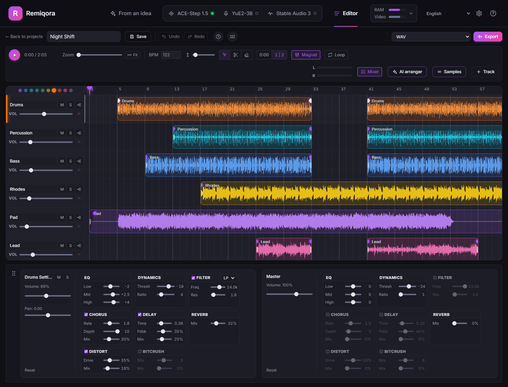

Any number of tracks, onto which you can add anything from the shared library (a full mix, a single stem, a file uploaded from disk) — via a picker dialog or by dragging a file straight onto a track. The picker has search, a "with stems" filter, a preview player with seeking and an **"As stems"** button that brings a track in as four lanes (splitting it first if it has no stems yet). A lane that plays one whole library track can be split into stems right on the timeline. The quickest way in is still the **"Open in editor"** button on the stems panel, which creates a ready-made four-track project (vocals, drums, bass, other).

The editor fills the whole window. The AI arranger and the mixer are panels you can drag to the top, the right or the bottom of the screen (by default the arranger sits on the right and the mixer at the bottom). Projects open from a list of cards that show each project's lanes, length, tempo and source track.

### Timeline and clips

- Free clip repositioning and edge trimming (non-destructive — the source file is untouched). Clips always snap to neighboring clips' edges and to timeline zero; the **Magnet** button additionally snaps to a grid derived from the project BPM (the step depends on zoom: 1/16, 1/8, 1/4 note, or a bar).
- **Split a clip** at the cursor (`S`), duplicate (`Ctrl+D`), delete (`Delete`).
- Buttons on the clip itself: **M** (mute), **S** (solo), **W** (warp) and ✕. Draggable **fade-in / fade-out** handles sit on the clip's edges; by default each edge gets an automatic 15 ms micro-fade that removes digital clicks from hard cuts.
- **Loop**: a loop region on the time ruler — drag it whole or pull either edge; clicking the ruler seeks.
- **BPM and Warp**: when a clip is added from the library or dragged in from disk, its tempo is detected automatically (from the first 30 seconds). The **BPM** field sets the project tempo, and the **W** button time-stretches the clip to it (SoundTouch) while preserving pitch. The detector is a simple one and can be off on complex material.
- **Undo/Redo** (`Ctrl+Z` / `Ctrl+Y`) — up to **30 steps** of history. Zoom with `Ctrl+wheel` or the slider and **Fit** button; pan the timeline with `Shift+drag` or the middle mouse button.

### Channels and effects

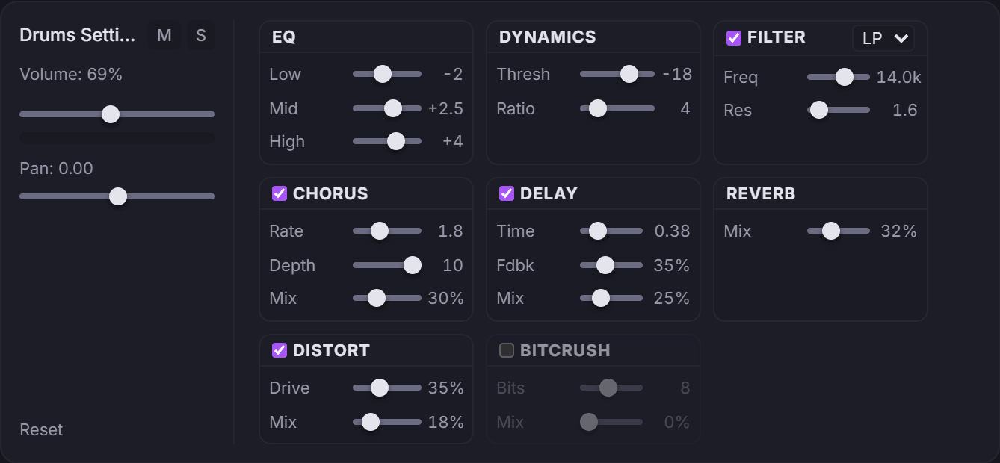

- Every track has volume, pan, mute/solo, and a color (the dots above the track list), plus a shared master bus.
- **An 8-effect rack** on every channel and on the master: EQ (Low/Mid/High, ±12 dB), Dynamics (compressor: threshold and ratio), Filter (LP/HP: frequency and resonance), Chorus, Delay, Reverb, Distortion, and Bitcrush. All effects run in real time, with parameter values shown next to the sliders.
- Stereo master VU meters (L/R) in the toolbar, and a level meter with clipping indication in the selected track's channel.

### Help

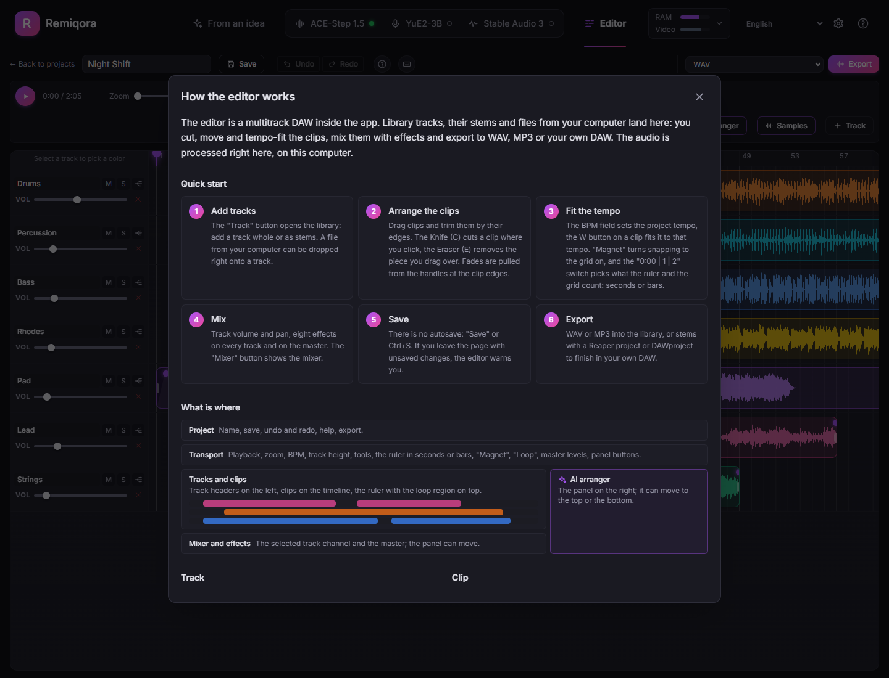

The **"?"** button in the toolbar opens a detailed guide: a quick start, a map of the screen, tracks and clips, tempo and loop, the eight effects, saving and export. The keyboard button (or the `?` key) shows the shortcut sheet, and the AI arranger has a guide of its own. The **?** in the app header explains every section, how the GPU is shared and which engine to pick.

### Project and export

- Projects are stored on the server and opened from a list. There is no autosave — use the **Save** button; if you close the tab or navigate away with unsaved edits, the editor warns you about losing them.
- Export the mixed-down project as **WAV** or **MP3** — rendered offline (the same processing graph as live playback) and saved back into the shared track library.
- Or export every lane as its own file to finish the track elsewhere: **stems + a Reaper project** (`.zip`) or a **DAWproject** file for Bitwig, Studio One and Cubase.

## AI arranger

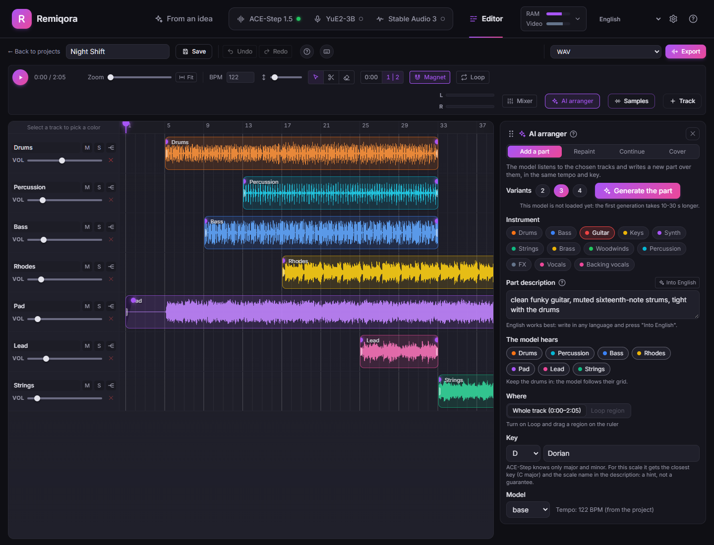

The arranger builds a track up step by step instead of generating it in one go. Open it with **AI arranger** in the editor toolbar:

- **Add a part** — pick an instrument (drums, bass, guitar, keys, synth, strings, brass, woodwinds, percussion, FX, vocals, backing vocals), describe it in a few words, and choose which lanes the model hears. It writes the part in their tempo and key. Vocals take lyrics, and the vocal language is guessed from the text.
- **Repaint** — rewrite a section you don't like (the loop region) while the rest stays.
- **Continue** — extend the track by a number of bars from its end or from the loop end.
- **Cover** — a new version of the chosen lanes in another style, with a strength slider.

Every run gives 2–4 variants, each on its own lane next to the source, so you can listen, keep the best one and go on to the next part; when a repaint is discarded, the original clip comes back. Adding parts needs ACE-Step's **base** model (about 4.8 GB, turbo cannot do it); the **XL base** model (about 20 GB, needs a 16 GB card or more) is an optional, more detailed alternative. The other modes run on turbo, or on **Stable Audio 3** when you pick it under *Engine · model*: it fills in and continues by listening to the audio on both sides of the range (inpainting) and covers by audio-to-audio, in seconds, instrumental only. In the desktop app the ACE-Step base models are optional at install and can be added later from the arranger itself.

### Samples

The **Samples** button next to the arranger makes sounds rather than parts: a **one-shot** (a kick, a hit, a whoosh), a **loop** of 1–8 bars at the project tempo, or a **texture** (rain, a crowd, a drone), from a short description in the style of a sample library. Results line up in a strip: listen first, then add the one you like to a new track or to the selected track at the playhead (or at the loop start). Loops are cut to whole bars, but the model does not guarantee a seamless join, so check them on repeat. Dismissing a job deletes its sounds from the library and the disk, except those a track still plays; those stay under the library's *Samples* filter. Needs Stable Audio 3 (the `small-sfx` checkpoint is the sound model; `medium` does sounds too). Two options help the raw output: *Trim leading silence* for one-shots (the clip starts on the attack) and *Seamless join* for loops (a 30 ms crossfade of the tail into the head, saved as its own library file).

**Samples on the CPU.** With *Make samples on the CPU* switched on (Models page → Stable Audio 3), the panel sends its jobs to a second Stable Audio server running on the processor, so ACE-Step or YuE2 stay on the GPU and nothing is unloaded. It starts with the first sample (about 10 s), takes about 3 GB of RAM and stops after a chosen time without use. The settings: when to use it (only when Stable Audio is not already on the GPU, or always), CPU threads, the model (`small-sfx` or `small-music`) and the idle time. For reference, on a 16-core Ryzen 9 9950X a 2 s one-shot takes about 13 s, 10 s of sound about 45 s.

On the Stable Audio 3 page itself: a description per variant (an A/B of two prompts in one run), automatic service tags (`TrackType: Music, VocalType: Instrumental` or `TrackType: SFX`, unless you typed a TrackType tag), several ranges to redo in one repaint, and the base checkpoints (`medium-base` and the small ones) when they are downloaded, with 50 steps, CFG 7 and a working negative prompt.

---

### Models and settings

The gear in the header opens the **Models** page: for every engine the weights it can download and the settings it starts with. ACE-Step: the core bundle, the other DiT checkpoints (`sft`, `base`, the XL ones) and the 0.6B and 4B language models, plus which DiT and language model it starts with. YuE2: the shared weights and the `q8_0` / `q4_0` / `bf16` main models. Stable Audio 3: the six checkpoints with the Hugging Face token, the model warmed up at start, and samples on the CPU. Demucs: `htdemucs` or the fine-tuned, slower `htdemucs_ft`. The prompt assistant of [From an idea](#from-an-idea): its model, the device (auto: the GPU while no engine runs, else the CPU; GPU: a running engine is unloaded while it writes, and *Generate* swaps it back), the idle time, and a box to try it with the same progress and *Stop*. The engines are listed on the left with what their models take on disk; an optional part can be deleted again from its row (not while its engine runs). **Check** on any downloaded part reads its files and says whether they are whole (YuE2: size and SHA-256 against Hugging Face's list, and whether the repository holds a newer file; ACE-Step: the safetensors headers, which catches a download that stopped half-way); **Re-download** fetches it again and replaces the files, for the required parts too. Downloads run in the background one at a time and can be stopped; a stopped one resumes. An engine's settings apply on its next start, and the page offers a restart when it runs with the old ones.

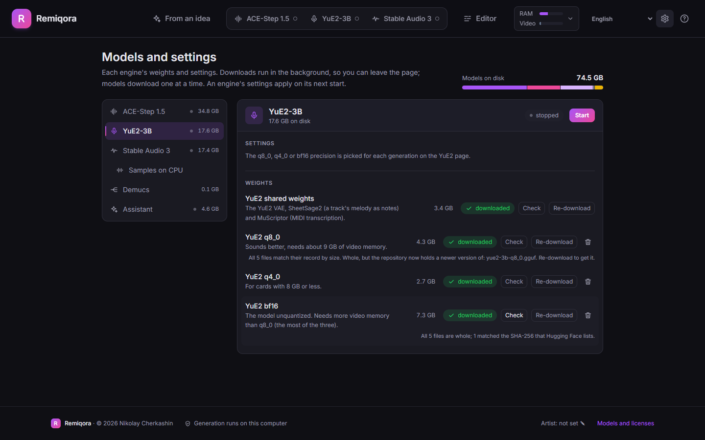

## Architecture

- **`backend/`** — FastAPI (Python). `app/orchestrator/` manages the models' process lifecycle (start/stop/health-poll) and enforces their mutual exclusion on a single GPU. `app/api/routes_proxy.py` reverse-proxies `/api/ace/*` → ACE-Step's REST API (port 8001) and `/api/yue2/*` → YuE2's native server (`audiocpp_server.exe`, port 8080). `app/db.py` + `routes_tracks.py` are the shared SQLite database and files, organized per model, regardless of how a track was created (generation, upload, or assembled in the editor).
- **`frontend/`** — Vue 3 + TypeScript + Tailwind v4 + Pinia + vue-router + vue-i18n. A fully native implementation (not an iframe) on top of the models' original APIs — `src/audio/` contains its own Web Audio engine (mixer, timeline, effects, a MIDI parser and synth, WAV/MP3 encoders).
- **`desktop/`** — an optional Electron shell and installer: first-run setup, server lifecycle and packaging. It runs the same `backend/` and `frontend/`; see [`desktop/README.md`](desktop/README.md).
- Only the models' own inference process (`acestep-api` and `audiocpp_server.exe`) runs from their original code — everything else (UI, proxying, storage, file upload/transcoding) is written in this repository. YuE2's own web UI (`web-ui/server.py`) is no longer used — the one useful part of it (transcoding non-WAV uploads via ffmpeg) has been ported to `backend/app/api/routes_yue2_upload.py`.

---

## Built with

Remiqora is a UI and orchestrator on top of third-party inference engines. Their code isn't vendored into this repository — only small functional patches (`external/patches/`) on top of the originals:

| Project | What's used | License |
|---|---|---|
| [ACE-Step-1.5](https://github.com/ace-step/ACE-Step-1.5) | Text/style-driven music generation engine, LoRA training | MIT |
| [audio.cpp](https://github.com/0xShug0/audio.cpp) (`dev` branch) | YuE2 (generation), SheetSage2 (melody extraction), MuScriptor (MIDI transcription) | Apache-2.0 |
| [Demucs](https://github.com/adefossez/demucs) | Stem separation (`htdemucs`) | MIT |
| [Stable Audio 3](https://github.com/Stability-AI/stable-audio-3) | Instrumentals and sound effects; inpainting, continuation and audio-to-audio in the arranger. Run through our own small server, `external/sa3-server` | Code MIT; weights under the [Stability AI Community License](https://stability.ai/community-license-agreement) (free below $1M annual revenue) plus the Gemma Terms of Use for the text encoder |
| [Qwen3.5](https://huggingface.co/Qwen/Qwen3.5-2B) | The prompt assistant of *From an idea* (0.8B, 2B or 4B), run through our own small server, `external/prompt-assistant`. Stable Audio's prompt instructions in it come from Stable Audio 3's `reprompt.py` (MIT) | Apache-2.0 (code and weights) |

Patch details and exact base commits are in [`external/patches/README.md`](external/patches/README.md). Stable Audio 3 in Remiqora is **Powered by Stability AI**.

The desktop app additionally uses [Electron](https://www.electronjs.org) (MIT), [electron-builder](https://www.electron.build) (MIT), [uv](https://docs.astral.sh/uv/) (MIT or Apache-2.0) and static FFmpeg builds (GPL) that it downloads on first launch instead of redistributing.

---

## License & liability for generated content

Remiqora's own code (this repository) is [MIT-licensed](LICENSE). That covers the UI and orchestrator only — it is a separate thing from the license of a *track* you generate with it. Remiqora is an orchestrator, not a generator with its own model — all audio is produced by third-party engines (ACE-Step 1.5, YuE2-3B, Stable Audio 3, and the SheetSage2/MuScriptor tools built on top of them). Because of that:

- **The author of Remiqora takes no responsibility** for what happens to tracks generated through this app afterward — commercial or otherwise, published or private. Whatever you create, and how you use it next, is entirely your own responsibility.
- **A generated track is covered by the license of whichever model produced it**, not by a license from this repository. The table above lists the *code* license — the *model weights* can be licensed differently:
  - **ACE-Step 1.5** — both the code and the model weights are MIT-licensed, and the model's authors explicitly state the generated music can be used commercially.
  - **YuE2-3B** — the model weights (unlike audio.cpp's own Apache-2.0 *code*) are distributed under **CC BY-NC 4.0**. That means tracks generated through YuE2 **cannot be used commercially** without separate permission from the rights holder, and attribution is required for any use.
  - **Stable Audio 3** — the code is MIT, the weights are under the [Stability AI Community License](https://stability.ai/community-license-agreement). It allows commercial use, the generated audio included, for individuals and organizations with under US $1M in annual revenue (counted together with affiliates); commercial use requires a free registration with Stability AI, and above that revenue a separate license from Stability AI is needed. You own the outputs as far as the law allows, but they may not be used to create or improve other foundation generative models. The text encoder also falls under the Gemma Terms of Use.
  - **The prompt assistant** (Qwen3.5, Apache-2.0) writes only text prompts, not audio; its license places no terms on what it writes.
- Before publishing, monetizing, or otherwise distributing a generated track, **check the current license terms of that specific model** on its HuggingFace/weights page — those terms belong to the model's own rights holder and can change independently of this repository.
- Remiqora is provided "as is", with no warranty of any kind. By using it, you accept that verifying a generated track's compliance with applicable law and with the license of the model that produced it is solely your responsibility.
- **Attribution**: if you fork, copy, or build on Remiqora's code, keep the credit — a link back to this repository and to Nikolay Cherkashin ([inikolax](https://github.com/inikolax)) as the original author. The MIT license above already requires keeping the copyright notice in any copy; this is just that requirement spelled out plainly.

---

## 📦 Installation

There are two ways to install Remiqora: the **desktop app** (experimental, described first) or the **scripts** (Steps 0–2 below).

### Desktop app (experimental)

For anyone who would rather not use a terminal, Remiqora also comes as a **desktop app** for **Windows** (NVIDIA RTX 20-series or newer, driver 580 or newer) and **macOS** (Apple Silicon). It opens in its own window and sets everything up on the first launch, so there is no Git, Python, CUDA Toolkit or compiler to install. The Windows installer installs per user and needs no administrator rights.

**Download (v0.5.1, pre-release):** [Windows installer (.exe)](https://github.com/inikolax/remiqora/releases/download/v0.5.1/Remiqora-Setup-0.5.1.exe) · [macOS installer (.dmg, Apple Silicon)](https://github.com/inikolax/remiqora/releases/download/v0.5.1/Remiqora-0.5.1-arm64.dmg) · [all files and SHA-256 sums](https://github.com/inikolax/remiqora/releases/tag/v0.5.1)

> [!WARNING]
> Official builds are published only on this repository's [Releases](https://github.com/inikolax/remiqora/releases) page and on [remiqora.com](https://remiqora.com). Copies of Remiqora under other GitHub accounts that offer a `.zip` "installer" are not ours and may carry malware: do not download or run them.

<p align="center">
  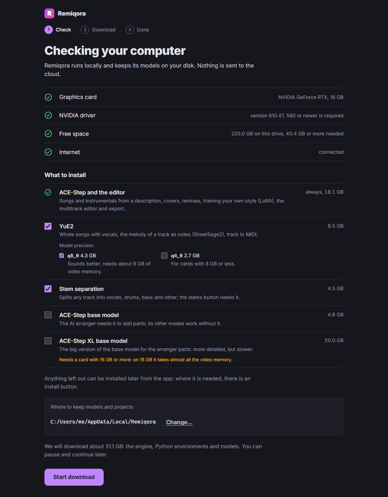
  
</p>

- **First launch.** The app checks the GPU, driver, free disk space and connection, lets you choose one folder for models and projects, and asks what to install. ACE-Step with the editor is always installed (about 18 GB: ACE-Step, its turbo model, FFmpeg and the Python environments). Everything else is a checkbox with its size:
  - **YuE2** (about 8.5 GB): the audio.cpp engine (CUDA on Windows, Metal on macOS), YuE2, SheetSage2 and MuScriptor. Its precision is a choice too — `q8_0` sounds better and needs about 9 GB of video memory, `q4_0` (2.7 GB) is for cards with 8 GB or less and is picked by default on such a card;
  - **Stem separation** (Demucs, about 4.5 GB);
  - **Stable Audio 3** (about 4.5 GB, off by default): its Python environment and the models ticked under it (`medium` 10.4 GB, `small-music` and `small-sfx` 3.5 GB each; `medium` is not offered on a Mac). The weights are gated on Hugging Face: accept the licence on each model page, then sign in with Hugging Face from the setup screen (a browser opens) or paste a token with the Read role; the setup checks the access before it starts. A pasted token stays in the data folder; the one from the browser sign-in expires after a few hours, so it serves the setup only. Models left out, and the open base checkpoints, can be downloaded later on the Models page;
  - **Prompt assistant** (about 4 GB, off by default) for *From an idea*: its Python environment, mostly shared with Stable Audio 3's when both are picked. Its model (Qwen3.5-2B, about 4.6 GB) is downloaded afterwards on the Models page;
  - **ACE-Step base model** (about 4.8 GB) for adding parts with the AI arranger;
  - **ACE-Step XL base model** (about 20 GB), off by default, with a warning when the card has less than 16 GB.

  The free space it asks for follows what is picked. Anything left out shows up in the app as "not installed" with an **Install** button that downloads just that part while the app keeps running. If the setup is interrupted, finished steps are skipped and downloads resume.
- **Every launch after that.** The app starts the server and opens the interface. Closing the window stops the model servers and frees the GPU.
- **Where things live.** Models, the database, generated audio and logs stay in the folder you chose, and nothing is uploaded anywhere. The folder cannot be moved later, because the database stores absolute paths.

**Status.** Experimental. The installers are not signed yet, so Windows shows a SmartScreen warning ("More info" → "Run anyway") and macOS says it cannot verify the app: close that message, open System Settings → Privacy & Security, click "Open Anyway" and confirm (needed once). If macOS instead says the app "is damaged and can't be opened" (the 0.2.1 build and earlier, [#33](https://github.com/inikolax/remiqora/issues/33)), drag it to Applications and run `xattr -dr com.apple.quarantine /Applications/Remiqora.app` in Terminal. The SHA-256 sum of every file is in `SHA256SUMS.txt` on the release page. To build an installer yourself instead:

```sh
cd frontend && npm ci && cd ../desktop && npm ci
npm run dist    # Windows: dist/Remiqora-Setup-<version>.exe · macOS (run it on a Mac): dist/Remiqora-<version>-arm64.dmg
```

[`desktop/README.md`](desktop/README.md) covers what the first run installs, the test switches and the known gaps.

**What it is built with.** An [Electron](https://www.electronjs.org) shell around the same web UI and FastAPI backend, packaged with [electron-builder](https://www.electron.build) (an NSIS installer on Windows, a DMG on macOS). The first launch uses [uv](https://docs.astral.sh/uv/) for the Python environments, the [audio.cpp](https://github.com/0xShug0/audio.cpp) release binaries and static FFmpeg builds. Licenses are unchanged; in particular the YuE2-3B weights stay CC BY-NC 4.0.

### Install from scripts

The steps below install from scripts instead: Git, a terminal and, on Windows, the build tools.

**On Windows, in one go:** double-click `install.bat`. It installs the toolchain if something is missing (then asks for a new window and `install.bat` again), sets up the engines and offers the ACE-Step base model the AI arranger needs. Then start Remiqora with `prod_run.bat` (`dev.bat` for development). The scripts speak Russian or English: the install asks once which (the default is the Windows display language) and the launchers keep to it; `REMIQORA_LANG=en` or `ru` overrides it, and deleting `.remiqora-lang` asks again. Steps 0 and 1 below are what `install.bat` runs.

### Step 0: build tools

```cmd
setup_prereqs.bat
```

Via `winget` (built into Windows 10/11), installs Git, Python, `uv`, Node.js,
CMake, ffmpeg, plus Visual Studio Build Tools (C++ workload) and the CUDA
Toolkit — those are large, need admin rights, and can take a while.
`setup_prereqs.bat -SkipHeavy` installs only the small, fast tools, leaving
Build Tools/CUDA for you to install manually from links the script prints.

**The NVIDIA GPU driver is deliberately left out** — install it by hand from
[nvidia.com/drivers](https://www.nvidia.com/drivers) for your card: silently
swapping a video driver on someone else's machine is risky (it can blank the
screen and usually needs a reboot on your schedule, not the script's).

After installing, close the terminal and open a new one so PATH picks up the
freshly installed tools.

**On macOS (Apple Silicon):**
```sh
./setup_prereqs.sh
```
Via [Homebrew](https://brew.sh), installs Git, Python, `uv`, Node.js, CMake,
ffmpeg and Ninja. No separate GPU driver step: Metal is built into macOS.
CMake/Ninja are only actually used by the `--from-source` build path below —
the default YuE2 setup needs no compiler at all.

### Step 1: generation engines

```cmd
setup_models.bat
```

The script:
1. Clones `ace-step/ACE-Step-1.5` (MIT) and `0xShug0/audio.cpp` (Apache-2.0,
   `dev` branch — YuE2 support is dev-only for now) into `external/`.
2. Applies a small patch to ACE-Step (a task-cancellation API; audio.cpp
   needs no patch, see `external/patches/README.md`) — without the upstream
   custom web-uis, which aren't needed.
3. Runs `uv sync` for ACE-Step and builds `audiocpp_server` (CUDA release,
   `yue2,sheetsage2,muscriptor` models) for audio.cpp.
4. Sets up `external/sa3-server`, our HTTP server around Stable Audio 3 (`uv sync`; the
   weights are downloaded only with `-StableAudioModels`, see below).
5. Downloads the YuE2/SheetSage2/MuScriptor GGUF weights (~10 GB) via
   audio.cpp's `tools/model_manager_v2.py`.
6. Sets up a `demucs` uv project in `external/Demucs` for stem separation,
   routed at PyTorch's cu128 wheel index so it gets a CUDA build (a plain
   `uv add demucs` would silently resolve a CPU-only torch wheel instead).
7. Creates `backend/.env` with paths to the freshly cloned repositories,
   including `FFMPEG_BIN_DIR` — auto-detected from `ffmpeg`'s winget install
   (`setup_prereqs.bat`), even right after installing it in the same
   terminal, before a new one would pick it up on PATH.

ACE-Step's own weights don't need a separate download — `acestep-api` pulls
them from HuggingFace/ModelScope on first request, the same way its Gradio
UI does.

**Stable Audio 3 weights** are downloaded in the app. The Models page (the gear in the header) lists the six checkpoints with their sizes, a *Download* button and the progress; a download can be stopped (finished files are kept, the file it was on starts over next time) and keeps running while you use other pages. `medium`, `small-music` and `small-sfx` are gated on Hugging Face: sign in there, press *Agree* on the model page, create a token with the *Read* role and paste it on the same page (it is saved to the Hugging Face cache, as `hf auth login` would). The `-base` checkpoints are open. Without the app: `setup_models.bat -StableAudioModels small-sfx,medium` (macOS: `--stable-audio-models=small-music,small-sfx`, Linux: `STABLE_AUDIO_MODELS="medium small-sfx"`), or `python -m sa3_server.download medium` with `external/sa3-server`'s own Python.

The script is idempotent — safe to re-run (the `-SkipBuild` / `-SkipWeights`
flags skip the corresponding steps). It expects `git`,
[`uv`](https://docs.astral.sh/uv/getting-started/installation/), Python 3,
CMake, the CUDA Toolkit and Visual Studio Build Tools (C++ workload) to
already be installed — if any is missing, that step is simply skipped with a
hint on what to install.

After that, the only manual step left is checking `CUDA_BIN_DIR` in
`backend/.env` (`FFMPEG_BIN_DIR` is filled in automatically — unless ffmpeg
wasn't found at all, in which case the script says so and it needs setting
by hand).

Hard machine requirements the script can't remove: Windows, a CUDA-capable
NVIDIA GPU (tested on an RTX 4080 16 GB), and an installed video driver.

**On macOS (Apple Silicon):**
```sh
./setup_models.sh
```
Adapted for macOS, with one difference from the Windows steps above: by
default, `audiocpp_server` is installed from audio.cpp's own **prebuilt
macOS/Metal release** (a pinned tag, sha256-verified before extracting) —
no compiler needed at all, unlike the Windows path, which always builds
from source since there's no prebuilt CUDA release. The Demucs uv project
also isn't routed at a CUDA wheel index — a plain `torch` dependency
already resolves an MPS-capable wheel on darwin/arm64, same as
ACE-Step-1.5's own `pyproject.toml` does. The written `backend/.env` has no
`CUDA_BIN_DIR` — there's no CUDA toolkit on this path.

Pass `--from-source` to build audio.cpp from the same pinned `dev` commit
Windows uses instead of downloading the release (useful if the release lags
behind a `dev`-only fix, or on Intel Macs, which the prebuilt asset doesn't
cover) — that path needs full **Xcode.app** (not just the Command Line
Tools) for its Metal shader compiler; `setup_prereqs.sh` prints exact steps
if it's missing. `--skip-build` / `--skip-weights` mirror `-SkipBuild` /
`-SkipWeights`. Otherwise it expects `git`, `uv` and Python 3 to already be
installed (`cmake` too, for `--from-source`).

Hard machine requirements this path can't remove: macOS, Apple Silicon
(M-series) for the default prebuilt path (Intel needs `--from-source`).
Tested on a MacBook Air, Apple M5, 24 GB RAM — including a from-scratch run
against a machine with no prior Homebrew packages or project state, all the
way through generating audio with YuE2 on the Metal backend.
This path is newer and less exercised than the Windows/CUDA one — expect it
to be slower (Metal instead of CUDA). `--from-source` in particular may
need occasional manual fixing up (a bumped commit pin) if audio.cpp's `dev`
branch drifts upstream; the default release-based path is pinned to a fixed
tag instead, so it doesn't drift on its own.

**On Linux (NVIDIA CUDA):**
```sh
./setup_linux.sh
```
Builds audio.cpp with its native Linux CUDA backend, installs ACE-Step and Demucs in isolated environments, downloads the model weights, and writes `backend/.env`. It expects git, Python 3.11/3.12, uv, Node.js 20.19+ (or 22.12+), npm, CMake, ffmpeg, and a CUDA toolkit with nvcc plus cuBLAS/cuFFT development headers. The NVIDIA driver is deliberately not installed or modified.

Tool paths are overrideable (`UV_BIN`, `NODE_BIN`, `NPM_BIN`, `CMAKE_BIN`, `NVCC_BIN`, `CUDA_TOOLKIT_PREFIX`, `CUDA_LIB_DIR`); `STABLE_AUDIO_MODELS="medium small-sfx"` also downloads those Stable Audio 3 checkpoints. On multi-GPU hosts, `ACE_STEP_DEVICE=0 YUE2_DEVICE=1 ./setup_linux.sh` pins the engines separately and enables concurrent model residency when the two explicit device values differ; leave either value unset (or set both to the same device) to retain the default exclusive switching behavior. Validated end-to-end on Ubuntu 24.04 x86_64 with NVIDIA CUDA.

### Step 2: run

```cmd
dev.bat
```
Brings up the backend (port 9000) and the frontend with Hot Module Replacement (Vite, port 5173), creates `backend/.venv` and `frontend/node_modules` on first run, and opens a browser at [http://localhost:5173](http://localhost:5173).

For production mode — build the SPA and serve everything from a single port:
```cmd
prod_run.bat
```
Builds the client via `npm run build` and serves the finished SPA bundle together with the API at [http://127.0.0.1:9000](http://127.0.0.1:9000).

Stem separation's `demucs` uv project is set up by `setup_models.bat` above; the `htdemucs` weights themselves download automatically on first use.

**On Linux:** `./prod_run_linux.sh` builds the frontend and serves the SPA and API on `127.0.0.1:9000` by default. Override with `REMIQORA_HOST` / `REMIQORA_PORT`. To opt in to LAN access, run `REMIQORA_HOST=0.0.0.0 ./prod_run_linux.sh`; Remiqora has no built-in authentication, so only expose it on a trusted network or behind an authenticated reverse proxy.

**With Docker (Linux + NVIDIA GPU):** the repository has a `Dockerfile` and `compose.yaml` with the web app and every engine. You need the NVIDIA driver, Docker with Compose and the [NVIDIA Container Toolkit](https://docs.nvidia.com/datacenter/cloud-native/container-toolkit/latest/install-guide.html).
```sh
docker compose up -d --build     # the first build takes about 25 minutes and makes a ~13 GB image
docker compose logs -f           # on the first start YuE2's weights download (~7 GB with the default q8_0)
```
Then open [http://127.0.0.1:9000](http://127.0.0.1:9000). Everything that changes (the library, settings, every engine's weights, the caches) lives in the `remiqora-data` volume, so `docker compose down` and a rebuild keep it. ACE-Step downloads its models on the first generation (about 9 GB, a few minutes); Stable Audio 3 and the prompt assistant get theirs from the Models page. `YUE2_PRECISIONS` in `compose.yaml` picks the YuE2 precisions (`q8_0`, `q4_0`, `bf16`). The port is published on 127.0.0.1 only: Remiqora has no login, so open it to the network only on a trusted one or behind an authenticating reverse proxy. Verified on Ubuntu 24.04 in WSL2 with an RTX 4080.

**On macOS:** `./dev.sh` and `./prod_run.sh` are the equivalents — same
behavior, except the backend/frontend run as background jobs of the script
itself (stop both with Ctrl+C) rather than in separate terminal windows.

---

## ⚙ Configuration (.env)

Settings live in `backend/.env` (template: `backend/.env.example`;
`setup_models.bat` creates it automatically with paths to the cloned repositories):
```ini
ACE_STEP_DIR=E:\AI\ACE\ACE-Step-1.5
YUE2_DIR=E:\AI\YuE2-3B
DEMUCS_DIR=E:\AI\Demucs
STABLE_AUDIO_DIR=E:\AI\StableAudio
FFMPEG_BIN_DIR=E:\AI\ACE\tools\ffmpeg-shared\ffmpeg-master-latest-win64-gpl-shared\bin
CUDA_BIN_DIR=C:\Program Files\NVIDIA GPU Computing Toolkit\CUDA\v13.4\bin
```

- `ACE_STEP_DIR` — root of the cloned and patched ACE-Step-1.5.
- `YUE2_DIR` — root of the cloned and patched audio.cpp (where `audiocpp_server.exe` is built and the YuE2/SheetSage2/MuScriptor GGUF weights live).
- `DEMUCS_DIR` — root of the `demucs` uv project used for stem separation.
- `STABLE_AUDIO_DIR` — root of the `sa3-server` uv project (a copy of `external/sa3-server` with its `.venv`). The Stable Audio 3 weights are read from the Hugging Face cache (`HF_HOME`) and downloaded from the app's Stable Audio 3 page (see *Stable Audio 3 weights* above); the main checkpoints are gated, so accept the licence on [`stabilityai/stable-audio-3-medium`](https://huggingface.co/stabilityai/stable-audio-3-medium) (and `-small-music` / `-small-sfx`) first. Optional: `STABLE_AUDIO_API_PORT` (8002), `STABLE_AUDIO_PRELOAD` (the checkpoint warmed up at start, `medium` by default), `STABLE_AUDIO_DEVICE`.
- `FFMPEG_BIN_DIR` — folder containing `ffmpeg.exe`/`ffprobe.exe`.
- `CUDA_BIN_DIR` — the `bin` folder of the installed CUDA Toolkit (needs to be on PATH for `audiocpp_server.exe`). Windows only — on macOS this is left unset, since YuE2 runs on the Metal backend instead.

---

## Known limitations

- The interface and installer are machine-translated into 18 languages (Russian and English are hand-written); no native speaker has reviewed them. The prompt assistant's lyrics in rarer languages are only as good as the 2B model that writes them.
- The engines (ACE-Step, YuE2, Stable Audio 3) switch exclusively by default. On multi-GPU Linux hosts, explicitly setting every `*_DEVICE` (`ACE_STEP_DEVICE`, `YUE2_DEVICE`, `STABLE_AUDIO_DEVICE`) to different device values opts into concurrent residency and pins each engine to its own GPU.
- Stable Audio 3 is instrumental only (no vocals), up to 380 s per task with the medium model, and its `medium` checkpoint needs a CUDA GPU with Flash Attention (prebuilt wheels are pinned for Windows and Linux; on macOS only the small models run). It cannot add a part over a mix: the arranger's "Add a part" stays with ACE-Step. Its main checkpoints are gated: a free Hugging Face account, the licence accepted once and a token are needed to download them.
- MIDI transcription requires YuE2 specifically to be active (the MuScriptor model loads into its process).
- Windows (NVIDIA CUDA), macOS/Apple Silicon (Metal/MPS), and Linux x86_64 (NVIDIA CUDA) have setup/run paths — `.bat`/`.ps1` scripts for the first, `.sh` scripts for the other two. Linux is community-contributed: it builds audio.cpp from source and needs a CUDA development toolkit in addition to the driver, and has been verified end-to-end on Ubuntu 24.04 (via WSL2 with GPU passthrough) rather than on bare metal or other distros.
- The desktop installers are experimental: unsigned (a SmartScreen or Gatekeeper prompt), and the first launch downloads from about 18 GB (ACE-Step only) to about 80 GB (everything, including the XL model, Stable Audio 3 and the prompt assistant with their models). The installer does not support Linux yet — Linux users run from source via `setup_linux.sh`.
- The macOS/Metal path is newer and less battle-tested than the Windows/CUDA one; expect it to be slower. By default it installs a prebuilt YuE2 binary pinned to a fixed release tag (no compiler needed); `--from-source` instead builds the same `dev` commit Windows uses, and may occasionally need that pin bumped if `dev` drifts.
