<p align="right"><a href="README.md">English</a> · <b>Русский</b></p>

<p align="center">
  
</p>

<h1 align="center">Remiqora</h1>
<p align="center"><i>Создано с AI. Сделано тобой.</i></p>

<p align="center">
  Локальная студия генерации и продакшна музыки на нейросетях — один интерфейс для <b>ACE-Step 1.5</b>, <b>YuE2-3B</b> и <b>Stable Audio 3</b> со встроенной многодорожечной DAW, <b>ИИ-аранжировщиком</b>, который дописывает в трек новые партии, и режимом <b>«Из идеи»</b>: одна фраза, а промт пишет локальная языковая модель.
</p>

<p align="center">🚧 В активной разработке — возможны breaking changes, баги и шероховатости. Ещё не стабильный релиз.</p>

<p align="center">
  <a href="https://remiqora.com/"></a>
  
  <a href="LICENSE.ru.md"></a>
  
  
  
  
  <a href="https://ko-fi.com/inikolax"></a>
</p>

<p align="center">
  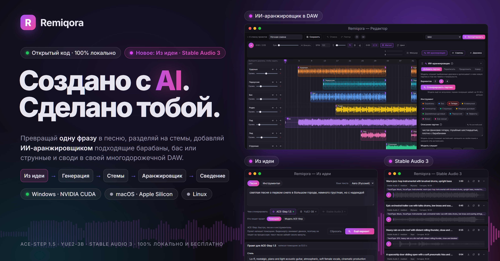
</p>

<p align="center">
  <a href="#зачем-это-нужно">Зачем</a> ·
  <a href="#что-внутри">Что внутри</a> ·
  <a href="#из-идеи">Из идеи</a> ·
  <a href="#языки">Языки</a> ·
  <a href="#ace-step-генерация">ACE-Step</a> ·
  <a href="#yue2-и-sheetsage2-генерация">YuE2</a> ·
  <a href="#stable-audio-3-генерация">Stable Audio 3</a> ·
  <a href="#тренировка-lora-ace-step">LoRA</a> ·
  <a href="#встроенный-daw">DAW</a> ·
  <a href="#ии-аранжировщик">ИИ-аранжировщик</a> ·
  <a href="#настольное-приложение-экспериментально">Настольное приложение</a> ·
  <a href="#основано-на">Основано на</a> ·
  <a href="#лицензия-и-ответственность-за-сгенерированный-контент">Лицензия</a> ·
  <a href="#-установка">Установка</a>
</p>

---

## Зачем это нужно

ACE-Step и YuE2 — два независимых движка генерации музыки, у каждого своя веб-морда, свой формат хранения результатов и свой процесс, который надо руками поднимать и гасить. На одной GPU одновременно они не помещаются. Remiqora решает это одним слоем:

- **Один UI** вместо двух разных интерфейсов с разным UX.
- **Взаимоисключающий оркестратор**: выбрали модель в шапке — она поднимается, а другая гасится сама. Не нужно руками стопать процессы перед стартом другого движка.
- **Общее хранилище**: все треки (сгенерированные, загруженные, собранные в редакторе) сохраняются в единой библиотеке (SQLite + файлы) и доступны из любого модуля — Demucs, MuScriptor и редактор работают с одной и той же библиотекой, а не тремя разными.
- **DAW поверх генерации**: результат генерации — это не конечная точка, а сырьё для дальнейшей сборки: разделить на стемы, перетащить на таймлайн, обработать эффектами, свести с другими треками и экспортировать.
- **ИИ-аранжировщик внутри DAW**: вместо того чтобы перегенерировать песню целиком, её можно собирать по партиям — модель слушает выбранные дорожки и дописывает барабаны, бас, струнные или новый кусок в их темпе и тональности, вариантами на отдельных дорожках.
- **Из идеи**: опишите песню одной фразой — локальная языковая модель напишет промт в формате выбранного движка (теги стиля, текст, темп, тональность), его можно поправить, а трек сделает движок.
- **Своя LoRA-тренировка**: не только генерация — можно дообучить ACE-Step на собственном голосе/стиле прямо из браузера, без консоли.
- **Ставится только нужное**: в настольном установщике можно не ставить YuE2, разделение на стемы или base-модели аранжировщика и доустановить их позже прямо из приложения; шапка показывает оперативную и видеопамять и умеет выгрузить работающую модель.

---

## Что внутри

| Модуль | Что делает |
|---|---|
| **ACE-Step 1.5** | Быстрая генерация музыки по тексту/тегам стиля, каверы, перерисовка фрагментов, извлечение/добавление партий поверх референсного трека. |
| **YuE2-3B** | Генерация полноформатных треков с CoT-планированием партитуры (символьный ABC-план перед аудио). |
| **Stable Audio 3** | Инструменталы и звуковые эффекты по описанию за секунды (без вокала); в AI-аранжировщике редактора перерисовывает, продолжает и делает кавер, слушая звук вокруг участка. |
| **SheetSage2** | Извлечение мелодии и гармонии из референсного аудио в ABC-нотацию — как основа для YuE2. |
| **Из идеи** | Одна фраза на входе, трек на выходе: локальная языковая модель (Qwen3.5) пишет промт для ACE-Step, YuE2 или Stable Audio 3, его можно поправить, и движок генерирует. |
| **Тренировка LoRA** | Датасет → авто-разметка → препроцессинг → тренировка → экспорт — весь пайплайн дообучения ACE-Step на своём голосе/стиле в браузере. |
| **Demucs** | Разделение любого трека на 4 стема: вокал, барабаны, бас, остальное. |
| **MuScriptor** | Транскрипция аудио (полного микса или отдельного стема) в MIDI-ноты. |
| **Встроенный DAW** | Многодорожечный таймлайн-редактор для сборки треков/стемов в финальный микс: рэк эффектов на каждом канале, авто-BPM и time-stretch, экспорт в WAV/MP3 или стемами с проектом Reaper / DAWproject, чтобы закончить в своей DAW. |
| **Сэмплы** | One-shot'ы, лупы в темпе проекта и текстуры по описанию (Stable Audio 3): прослушиваются в редакторе и ставятся на дорожку. |
| **ИИ-аранжировщик** | Добавляет партию (барабаны, бас, струнные, клавишные, вокал и другие) поверх выбранных дорожек, перерисовывает участок, продолжает трек или делает кавер в другом стиле — каждый вариант ложится на свою дорожку. |

Интерфейс и установщик Remiqora доступны на 20 языках: см. [Языки](#языки).

---

## Из идеи


Первая вкладка в шапке. Опишите песню или инструментал своими словами, выберите движок, и локальная языковая модель, помощник промтов, напишет промт в формате этого движка:

- **ACE-Step**: описание стиля, текст, темп, тональность и длительность. Пока движок запущен, промт может написать и собственная языковая модель ACE-Step: быстрее, но дальше от идеи.
- **YuE2** (песни): первым тегом язык песни (`Russian`, `English`...), затем 5–9 тегов стиля по-английски и текст по секциям на языке идеи или на выбранном.
- **Stable Audio 3** (инструменталы и звуки): сначала собственный классификатор Stable Audio решает, музыка это или звук («дождь по стеклу» — звук, а не песня), затем промт пишется по его инструкциям для этого вида; переключатель «Музыка / Звук» исправит ошибку, а для звука берётся чекпойнт `small-sfx`, если он скачан.

Пока промт пишется, страница показывает этап, примерный процент, растущий текст и кнопку «Остановить». Затем промт открывается полями для правки. «Сгенерировать» при необходимости запускает движок и отправляет задачу; трек называется по идее и попадает в ленту движка. «Открыть в форме» переносит промт на страницу движка ради настроек, которых здесь нет, и форма подхватывает его, как только движок запустится. Идея и промт остаются на месте, если уйти со страницы, и после перезагрузки.

Помощник — Qwen3.5 (0.8B, по умолчанию 2B или 4B; Apache-2.0), он скачивается и настраивается на странице «Модели». В режиме «авто» он пишет на видеокарте, пока не запущен ни один движок, и на процессоре в остальных случаях: текст песни занимает около 10 с на видеокарте и до минуты на процессоре. В режиме «видеокарта» он на время письма выгружает работающий движок, а «Сгенерировать» возвращает движок обратно. Помощник запускается с первым запросом и останавливается после заданного простоя.

---

## Языки

**Remiqora говорит на 20 языках**: интерфейс, справка и гайды, а также экран первого запуска (установщик). Он открывается на языке системы (переключатель в шапке это меняет) и подгружает язык только когда вы его выбрали.

| | |
|---|---|
| **Написаны вручную** | Русский · English |
| **Европа** | Español · Português (Brasil) · Deutsch · Français · Italiano · Polski · Українська · Türkçe |
| **Азия** | Қазақша · 简体中文 · 繁體中文 · 日本語 · 한국어 · Tiếng Việt · Bahasa Indonesia · हिन्दी |
| **Справа налево** | العربية · فارسی · עברית |

> **Все языки, кроме русского и английского, это машинный перевод.** Большая языковая модель перевела 1 831 строку интерфейса и 140 строк установщика на каждый язык; скрипты проверили, что все ключи и подстановки совпадают с английским текстом. Носители языка их не вычитывали, поэтому возможны неловкие формулировки и неверные термины, больше всего в редких языках. Традиционный китайский получен из упрощённого через OpenCC. Исправления приветствуются.

Арабский, фарси и иврит зеркалят весь интерфейс. Таймлайн, волна и микшер остаются слева направо намеренно: время и направление сигнала не зеркалятся.

### Идеи и песни на любом языке

- **«Из идеи»** работает на всех 20 языках и на 51 языке вокала из списка *«Язык текста»*. Язык вашей идеи определяется по алфавиту, особым буквам и самым частым словам (проверено на 65 текстах на 20 языках, без промахов); если определить нельзя, выберите язык вручную.
- **Казахский** в списке самого ACE-Step нет, поэтому его проверили: с тегом `kk` ACE-Step поёт не хуже, чем с `ru` (средняя ошибка 0,45 против 0,43 на девяти seed каждого), так что `kk` отправляется как есть.
- **Качество зависит от модели.** Ассистент по умолчанию (Qwen3.5-2B) всегда пишет на запрошенном языке, но стихи на казахском и хинди выходят неуклюжими; модель 4B на странице «Модели» справляется заметно лучше.

### Что проверено (октябрь 2026)

**Ассистент промптов.** Идею, написанную на каждом из 20 языков, отправили ассистенту дважды: для песни YuE2 и для песни ACE-Step. Детектор языка подтвердил, что текст вернулся на запрошенном языке в каждом ответе (индонезийский он назвал «малайским», текст индонезийский). Около 7 % запросов (3 из 40) сначала упали на невалидном JSON от маленькой модели, и на английском тоже, поэтому ассистент теперь пробует три раза вместо двух; 24 повторных запуска прошли чисто.

**Настоящие песни.** Одну короткую песню с одним и тем же четырёхстрочным текстом, переведённым на каждый язык, сгенерировали в **ACE-Step** (48 с) и в **YuE2** (22-51 с), вокал отделили через Demucs, а **Whisper large-v3** распознал его. В таблице показано, какая доля эталонного текста нашлась в расшифровке.

<details>
<summary><b>Доля текста, которую нашёл Whisper в каждой песне</b></summary>

| Язык | ACE-Step | YuE2 |
|---|--:|--:|
| English | 70 % | 100 % |
| Русский | 56 % | 99 % |
| Español | 71 % | 100 % |
| Português | 82 % | 98 % |
| Deutsch | 76 % | 100 % |
| Français | 78 % | 100 % |
| Italiano | 92 % | 100 % |
| Polski | 79 % | 100 % |
| Українська | 91 % | 89 % |
| Türkçe | 10 % | 96 % |
| 中文 | 0 % | 94 % |
| 日本語 | 14 % | 95 % |
| 한국어 | 48 % | 93 % |
| Tiếng Việt | 44 % | 27 % |
| Bahasa Indonesia | 18 % | 100 % |
| हिन्दी | 64 % | 91 % |
| العربية | 20 % | 67 % |
| فارسی | 70 % | 84 % |
| עברית | 10 % | 97 % |
| Қазақша | 83 % | 79 % |
| **среднее** | **54 %** | **90 %** |

Это ориентир, а не приговор: по одной песне на язык и движок, Whisper сам ненадёжен на пении, а низкое значение ACE-Step (китайский, японский, турецкий, иврит) значит «не распознано в этом образце», а не «не поддерживается»: в коротких клипах вокал часто начинается поздно. YuE2 спел текст почти на всех языках, включая те, которых нет в списке его авторов; его вставки «hey, oh» мы не засчитывали как ошибки.

</details>

Тестовые песни в репозиторий не входят.

---

## ACE-Step: генерация

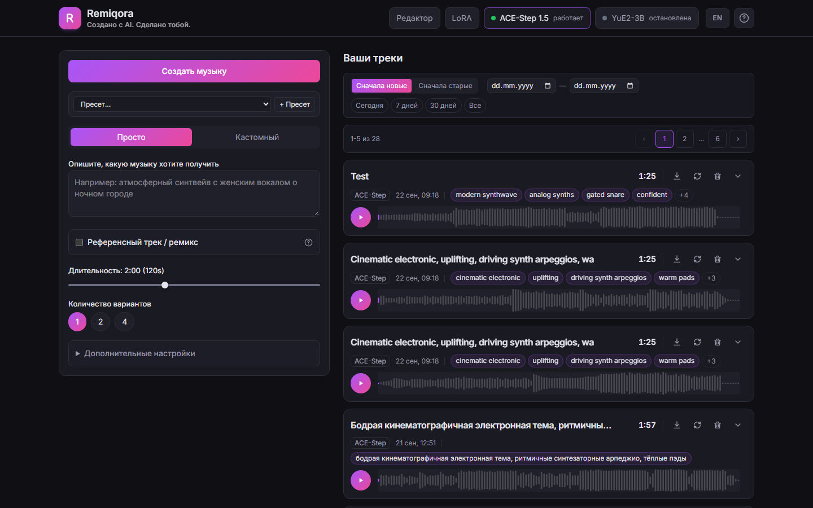

Два режима ввода: **«Просто»** — одно текстовое описание, из которого модель сама выводит стиль и текст песни; и **«Кастомный»** — отдельно теги стиля (с автодополнением) и текст с разметкой структуры (`[Verse]/[Chorus]/[Bridge]`) и исполнительскими аннотациями (`(whisper)`, `(falsetto)`), либо чекбокс «Инструментал».

Если приложить референсный трек, открываются 5 сценариев ремикса:
- **Кавер** — рестайлинг с сохранением мелодии (регулируется силой сохранения оригинала).
- **Перерисовать участок** — заменить только выбранный отрезок трека.
- **Извлечь партию** — вытащить один инструмент/голос из готового микса (12 вариантов: вокал, барабаны, бас, гитара и т.д.).
- **Добавить партию** — досочинить один недостающий инструмент поверх микса.
- **Дописать композицию** — то же самое, но сразу для списка партий.

Плюс: длительность 10–300 сек, батч 1/2/4 варианта, форматы mp3/wav/flac, расширенные параметры (BPM, тональность, размер такта, язык вокала — по умолчанию определяется по тексту, шаги инференса, guidance scale, seed), поддержка LoRA-адаптеров с регулировкой силы, локальные пресеты параметров и кнопка «Остановить всё» для массовой отмены задач.

## YuE2 и SheetSage2: генерация

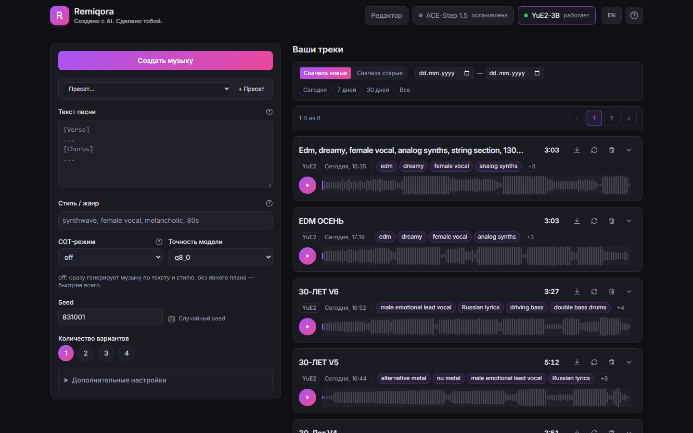

Три режима **CoT (Chain-of-Thought)**: `off` — сразу в аудио; `melody` — аранжировка строится вокруг заданной мелодии (ABC); `full` — модель сначала строит символьный план (мелодия+аккорды), потом генерирует аудио.

**SheetSage2** позволяет загрузить референсный трек и одной кнопкой получить его мелодию в ABC-нотации прямо в форме — можно редактировать вручную. Дальше: точность `q8_0`/`q4_0`, батч 1–4, полный набор sampling-параметров отдельно для аудио-генерации и для ABC-планировщика, локальные пресеты, и просмотр/повторное использование ABC-партитуры уже сгенерированного трека.

## Stable Audio 3: генерация


Инструменталы и звуковые эффекты по описанию за секунды; без вокала. Выберите **Музыку** или **Звук**, опишите по-английски (жанр, инструменты, настроение и темп; для звука его источник, как он возникает и помещение), задайте длину (до 6 минут на `medium`, до 2 на small-чекпойнтах) и 1, 2 или 4 варианта. **Опорный трек** превращает ту же форму в кавер (audio-to-audio с ползунком близости), переписывание одного или нескольких участков или продолжение. Шесть чекпойнтов скачиваются на странице «Модели»; страница показывает, сколько из них есть. Подробнее о настройках страницы — в разделе [Сэмплы](#сэмплы).

## Тренировка LoRA (ACE-Step)

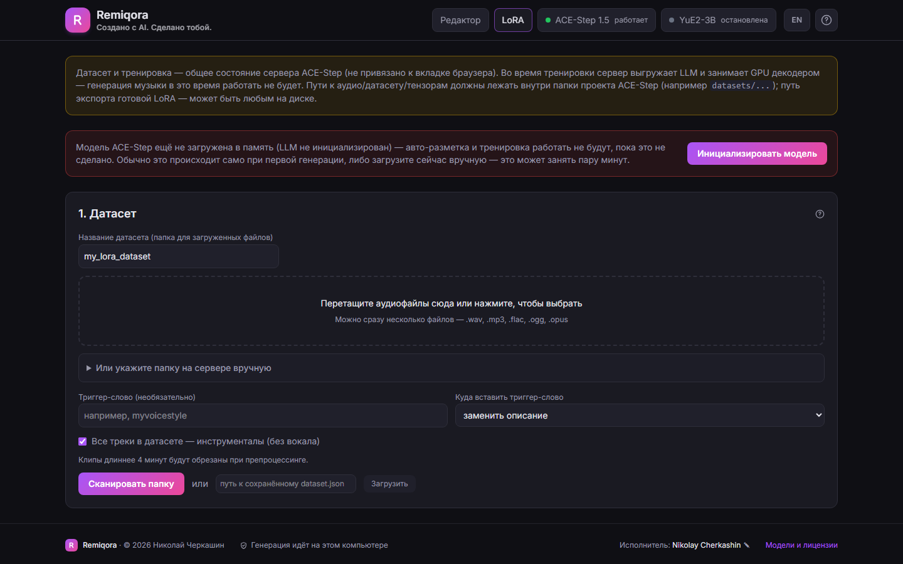

Полный пайплайн дообучения ACE-Step на своём датасете, без консоли. Это вкладка на странице ACE-Step, рядом с «Генерацией»:

1. **Датасет** — загрузка аудиофайлов прямо через браузер (drag & drop) или указание готовой папки на сервере, триггер-слово, пометка «все треки инструментальные».
2. **Автоматическая разметка** — LLM-описание, жанр, BPM/тональность, распознавание/переформатирование текста песни.
3. **Проверка и правка** — таблица всех сэмплов с возможностью поправить описание/жанр/теги перед тренировкой.
4. **Препроцессинг** — конвертация размеченных сэмплов в тензоры.
5. **Тренировка** — LoRA rank/alpha/dropout, learning rate, эпохи, batch size, FP8, gradient checkpointing, живой прогресс с ETA и ссылкой на TensorBoard.
6. **Экспорт и реестр** — готовый адаптер сразу попадает в список LoRA на форме генерации.

## Разделение на стемы (Demucs)

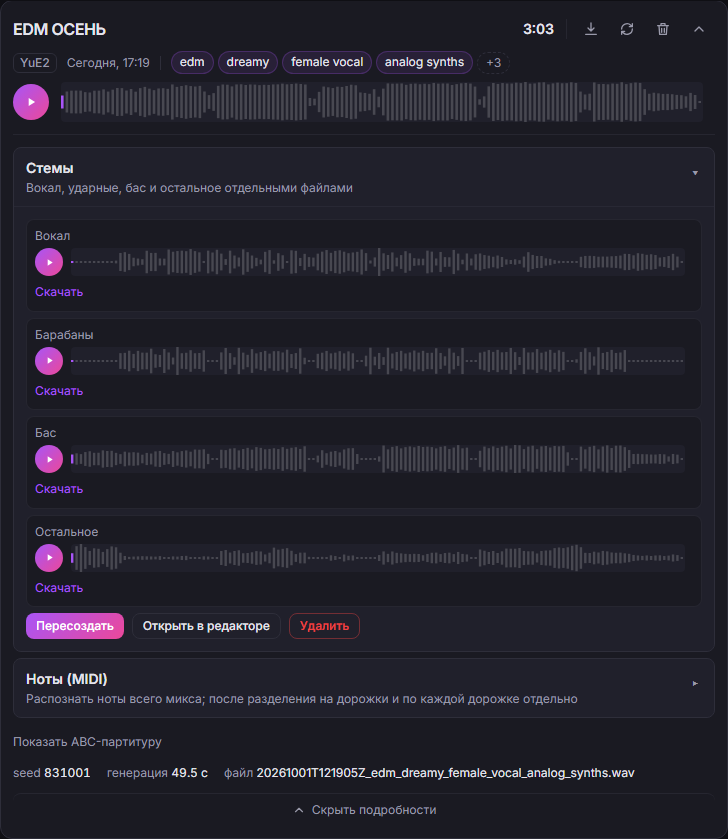

Одной кнопкой любой сохранённый трек режется на 4 изолированных стема (Demucs `htdemucs`), с прогресс-баром, отдельным плеером и скачиванием на каждый стем, возможностью пересоздать или удалить. Работает параллельно с активной моделью генерации (не останавливая её) на общем GPU-локе. Кнопка **«Открыть в редакторе»** позволяет мгновенно отправить все 4 стема в новый проект встроенного DAW для последующего сведения.

## Транскрипция в MIDI (MuScriptor)

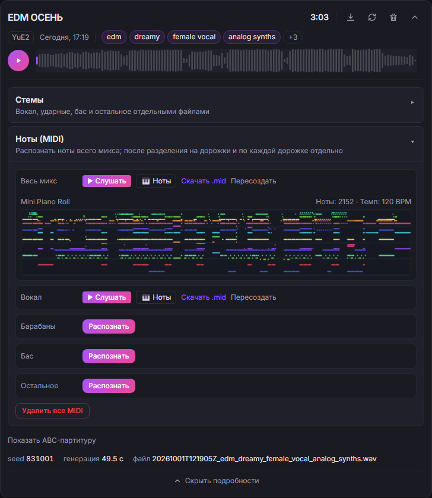

Транскрибирует в MIDI полный микс или любой уже отделённый стем по отдельности. Технически это не отдельный процесс, а модель, подгружаемая в уже запущенный сервер YuE2 — поэтому **транскрипция требует, чтобы активной моделью была именно YuE2**. Результат: встроенный плеер на Web Audio синтезаторе, мини Piano Roll, счётчик нот и BPM, скачивание `.mid`.

## Встроенный DAW

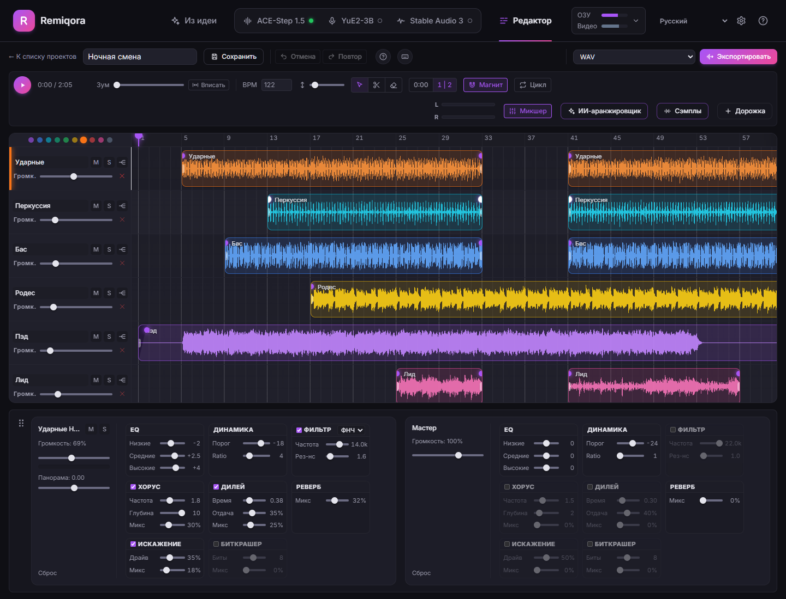

Произвольное число дорожек, на которые можно добавлять что угодно из общей библиотеки (полный микс, отдельный стем, загруженный с диска файл) — через диалог выбора или прямым перетаскиванием файла на дорожку. В окне выбора есть поиск, фильтр «со стемами», плеер с перемоткой и кнопка **«Стемами»**: трек добавляется сразу четырьмя дорожками (если стемов ещё нет, он сначала делится). Дорожку, на которой целиком лежит трек из библиотеки, можно разделить на стемы прямо на таймлайне. Быстрее всего по-прежнему начать с кнопки **«Открыть в редакторе»** на панели стемов: она создаёт готовый проект из четырёх дорожек (вокал, барабаны, бас, остальное).

Редактор занимает всё окно. ИИ-аранжировщик и микшер — панели, которые можно перетащить вверх, вправо или вниз (по умолчанию аранжировщик справа, микшер снизу). Проекты открываются из списка карточек, где видны дорожки проекта, длина, темп и исходный трек.

### Таймлайн и клипы

- Свободное перемещение и обрезка краёв клипов (не разрушающая — исходный файл не трогается). Клипы всегда прилипают к краям соседних клипов и к нулю таймлайна; кнопка **Magnet** дополнительно включает привязку к сетке по BPM проекта (шаг зависит от масштаба: 1/16, 1/8, 1/4 ноты или такт).
- **Разрез клипа** под курсором (`S`), дублирование (`Ctrl+D`), удаление (`Delete`).
- Кнопки на самом клипе: **M** (mute), **S** (solo), **W** (warp) и ✕. По краям клипа — перетаскиваемые ручки **fade-in / fade-out**; по умолчанию на краях стоят автоматические 15 мс микрофейды, убирающие цифровые щелчки на резких обрезках.
- **Loop**: регион зацикливания на линейке времени — его можно двигать целиком и тянуть за оба края; клик по линейке перематывает воспроизведение.
- **BPM и Warp**: при добавлении клипа из библиотеки или перетаскиванием с диска темп определяется автоматически (по первым 30 секундам). Поле **BPM** задаёт темп проекта, а кнопка **W** подгоняет клип под этот темп time-stretch'ем (SoundTouch), сохраняя тональность. Детектор простой — на сложном материале может ошибаться.
- **Undo/Redo** (`Ctrl+Z` / `Ctrl+Y`) — история до **30 шагов**. Зум — `Ctrl+колесо` или ползунок с кнопкой **Fit**, прокрутка таймлайна — `Shift+перетаскивание` или средняя кнопка мыши.

### Каналы и эффекты

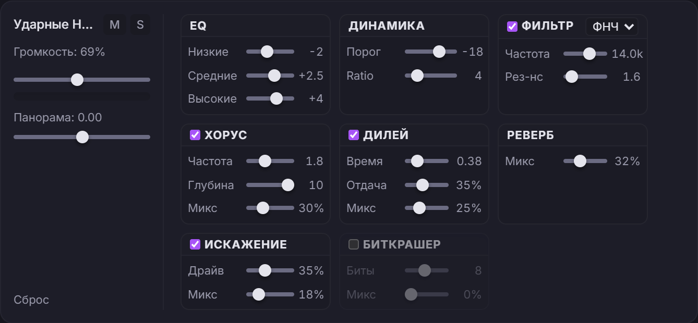

- У каждой дорожки — громкость, панорама, mute/solo и цвет (кружки над списком дорожек), плюс общая мастер-шина.
- **Рэк из 8 эффектов** на каждом канале и на мастере: Эквалайзер (Low/Mid/High, ±12 дБ), Динамика (компрессор: порог и ratio), Фильтр (LP/HP: частота и резонанс), Хорус, Дилей, Реверб, Искажение и Биткрашер. Все эффекты работают в реальном времени, значения параметров показываются рядом со слайдерами.
- Стерео VU-метры мастера (L/R) в тулбаре и индикатор уровня с признаком клиппинга в канале выбранной дорожки.

### Справка

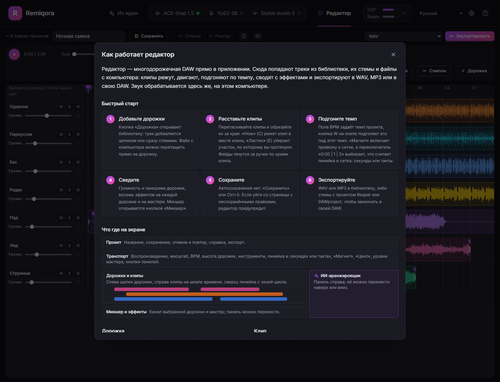

Кнопка **«?»** в тулбаре открывает подробную справку: быстрый старт, карта экрана, дорожки и клипы, темп и цикл, восемь эффектов, сохранение и экспорт. Кнопка с клавиатурой (или клавиша `?`) показывает горячие клавиши, у ИИ-аранжировщика своя справка. Кнопка **?** в шапке приложения объясняет все разделы, как делится видеокарта и какой движок выбрать.

### Проект и экспорт

- Проекты хранятся на сервере и открываются из списка. Автосохранения нет — есть кнопка **«Сохранить»**, а при закрытии вкладки или переходе на другую страницу с несохранёнными правками редактор предупреждает о возможной потере.
- Экспорт сведённого проекта в **WAV** или **MP3** — рендерится оффлайн (тот же граф обработки, что и при живом воспроизведении) и сохраняется обратно в общую библиотеку треков.
- Или экспорт каждой дорожки отдельным файлом, чтобы закончить трек в другой программе: **стемы + проект Reaper** (`.zip`) или файл **DAWproject** для Bitwig, Studio One и Cubase.

## ИИ-аранжировщик

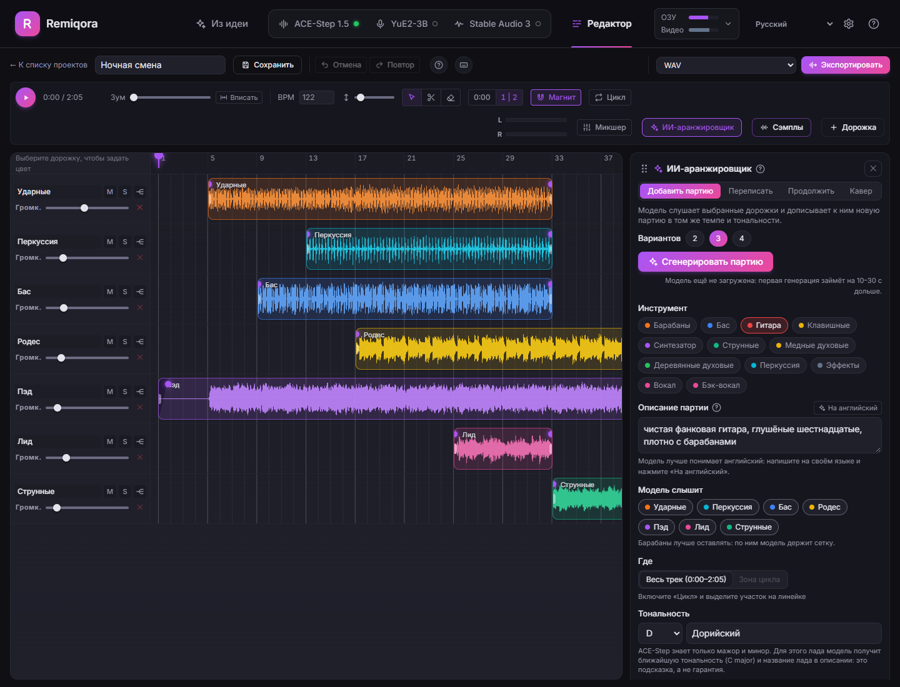

Аранжировщик собирает трек по шагам, а не генерирует его целиком. Он открывается кнопкой **«ИИ-аранжировщик»** в тулбаре редактора:

- **Добавить партию** — выберите инструмент (барабаны, бас, гитара, клавишные, синтезатор, струнные, медные и деревянные духовые, перкуссия, эффекты, вокал, бэк-вокал), опишите его парой слов и отметьте, какие дорожки слышит модель. Партия пишется в их темпе и тональности. Для вокала задаётся текст, язык вокала определяется по тексту.
- **Переписать** — заново сочинить неудачный участок (регион цикла), остальное не меняется.
- **Продолжить** — дописать трек на несколько тактов от конца или от конца цикла.
- **Кавер** — новая версия выбранных дорожек в другом стиле, с ползунком силы.

Каждый запуск даёт 2–4 варианта, каждый на своей дорожке рядом с исходной: можно послушать, оставить лучший и перейти к следующей партии; если отказаться от перерисовки, исходный клип вернётся. Для добавления партий нужна **base**-модель ACE-Step (около 4,8 ГБ, turbo так не умеет); **XL base** (около 20 ГБ, нужна видеокарта от 16 ГБ) — необязательная, более подробная альтернатива. Остальные режимы работают на turbo либо на **Stable Audio 3**, если выбрать его в поле *Движок · модель*: он дорисовывает и продолжает, слушая звук по обе стороны участка (inpainting), а кавер делает через audio-to-audio — за секунды и только инструментал. В настольном приложении обе модели ставятся по желанию и доустанавливаются позже прямо из аранжировщика.

### Сэмплы

Кнопка **«Сэмплы»** рядом с аранжировщиком делает не партии, а звуки: **one-shot** (кик, удар, вжух), **луп** на 1–8 тактов в темпе проекта или **текстуру** (дождь, толпа, дрон) по короткому описанию в духе библиотеки сэмплов. Результаты выстраиваются лентой: сначала послушайте, потом добавьте понравившийся на новую дорожку или на выбранную от курсора (или от начала цикла). Лупы режутся по целым тактам, но бесшовный стык модель не гарантирует, так что проверяйте на повторе. Если убрать задачу, её звуки удаляются из библиотеки и с диска, кроме тех, что звучат на дорожках: они остаются под фильтром «Сэмплы». Нужен Stable Audio 3 (чекпойнт `small-sfx` — звуковая модель; `medium` тоже умеет звуки). Два переключателя доводят сырой результат: «Обрезать тишину в начале» для one-shot (клип начинается с атаки) и «Бесшовный стык» для лупов (кроссфейд 30 мс хвоста в начало, сохраняется отдельным файлом библиотеки).

**Сэмплы на процессоре.** Если включить «Считать сэмплы на процессоре» (страница «Модели» → Stable Audio 3), панель отправляет задачи второму серверу Stable Audio на процессоре: ACE-Step или YuE2 остаются на видеокарте, ничего не выгружается. Сервер запускается с первым сэмплом (около 10 с), занимает около 3 ГБ памяти и останавливается после выбранного времени без дела. Настройки: когда им пользоваться (только если Stable Audio ещё не на видеокарте, или всегда), число потоков, модель (`small-sfx` или `small-music`) и время до выгрузки. Для ориентира: на 16-ядерном Ryzen 9 9950X one-shot на 2 с считается около 13 с, 10 с звука около 45 с.

На самой странице Stable Audio 3: своё описание на вариант (A/B двух промптов за один запуск), автоматические служебные теги (`TrackType: Music, VocalType: Instrumental` или `TrackType: SFX`, если вы не написали тег TrackType сами), несколько участков за одно переписывание и base-чекпойнты (`medium-base` и small-версии), когда они скачаны: 50 шагов, CFG 7 и рабочий негативный промпт.

---

### Модели и настройки

Шестерёнка в шапке открывает страницу **«Модели»**: для каждого движка веса, которые можно скачать, и настройки, с которыми он запускается. ACE-Step: основной набор, другие DiT-модели (`sft`, `base`, XL) и языковые модели 0.6B и 4B, а также с какой DiT и языковой моделью он стартует. YuE2: общие веса и основные модели `q8_0` / `q4_0` / `bf16`. Stable Audio 3: шесть чекпойнтов с токеном Hugging Face, модель для прогрева при запуске и сэмплы на процессоре. Demucs: `htdemucs` или дообученная, более медленная `htdemucs_ft`. Помощник промтов для режима [«Из идеи»](#из-идеи): модель, устройство (авто: видеокарта, пока не запущен ни один движок, иначе процессор; видеокарта: на время промта работающий движок выгружается, а «Сгенерировать» возвращает его), время простоя и поле, чтобы попробовать, с тем же прогрессом и кнопкой «Остановить». Движки перечислены слева вместе с тем, сколько их модели занимают на диске; необязательную модель можно удалить прямо из её строки (не пока движок работает). **«Проверить»** у любой скачанной части читает её файлы и говорит, целы ли они (YuE2: размер и SHA-256 по списку Hugging Face, а также есть ли в репозитории более новый файл; ACE-Step: заголовки safetensors, это ловит оборванную закачку); **«Скачать заново»** загружает её ещё раз и заменяет файлы, в том числе у обязательных частей. Скачивание идёт в фоне по одной модели, его можно остановить и потом продолжить. Настройки движка применяются при его следующем запуске; если он работает со старыми, страница предлагает перезапуск.

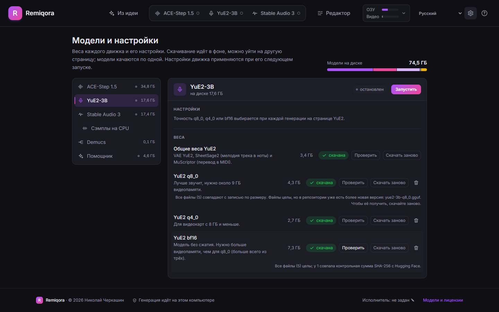

## Архитектура

- **`backend/`** — FastAPI (Python). `app/orchestrator/` управляет жизненным циклом процессов моделей (старт/стоп/health-poll) и обеспечивает их взаимное исключение на одной GPU. `app/api/routes_proxy.py` реверс-проксирует `/api/ace/*` → REST API ACE-Step (порт 8001) и `/api/yue2/*` → нативный сервер YuE2 (`audiocpp_server.exe`, порт 8080). `app/db.py` + `routes_tracks.py` — общая SQLite-база и файлы, разложенные по модели, независимо от того, как трек был создан (генерация, загрузка, сборка в редакторе).
- **`frontend/`** — Vue 3 + TypeScript + Tailwind v4 + Pinia + vue-router + vue-i18n. Полностью нативная реализация (не iframe) поверх оригинальных API моделей — `src/audio/` содержит собственный движок Web Audio (микшер, таймлайн, эффекты, MIDI-парсер и синтезатор, кодировщики WAV/MP3).
- **`desktop/`** — необязательная оболочка на Electron и установщик: первая настройка, управление жизненным циклом сервера и упаковка. Запускает те же `backend/` и `frontend/`; см. [`desktop/README.md`](desktop/README.md).
- Из кода самих моделей запускается только их процесс инференса (`acestep-api` и `audiocpp_server.exe`) — все остальное (UI, прокси, хранилище, загрузка/транскодирование файлов) написано в этом репозитории. Собственный веб-UI YuE2 (`web-ui/server.py`) больше не используется — единственная полезная часть (транскодирование не-WAV загрузок через ffmpeg) перенесена в `backend/app/api/routes_yue2_upload.py`.

---

## Основано на

Remiqora — это UI и оркестратор поверх сторонних движков инференса. Их код в этот репозиторий не вкладывается, только небольшие функциональные патчи (`external/patches/`) поверх оригиналов:

| Проект | Что используется | Лицензия |
|---|---|---|
| [ACE-Step-1.5](https://github.com/ace-step/ACE-Step-1.5) | Движок генерации музыки по тексту/стилю, LoRA-тренировка | MIT |
| [audio.cpp](https://github.com/0xShug0/audio.cpp) (ветка `dev`) | YuE2 (генерация), SheetSage2 (извлечение мелодии), MuScriptor (транскрипция в MIDI) | Apache-2.0 |
| [Demucs](https://github.com/adefossez/demucs) | Разделение треков на стемы (`htdemucs`) | MIT |
| [Stable Audio 3](https://github.com/Stability-AI/stable-audio-3) | Инструменталы и звуковые эффекты; inpainting, продолжение и audio-to-audio в аранжировщике. Запускается через наш небольшой сервер `external/sa3-server` | Код MIT; веса под [Stability AI Community License](https://stability.ai/community-license-agreement) (бесплатно при доходе до $1 млн в год) плюс Gemma Terms of Use для текстового энкодера |
| [Qwen3.5](https://huggingface.co/Qwen/Qwen3.5-2B) | Помощник промтов для режима «Из идеи» (0.8B, 2B или 4B), запускается через наш небольшой сервер `external/prompt-assistant`. Инструкции для промтов Stable Audio в нём взяты из `reprompt.py` Stable Audio 3 (MIT) | Apache-2.0 (код и веса) |

Подробности патчей и точные базовые коммиты — в [`external/patches/README.md`](external/patches/README.md). Stable Audio 3 в Remiqora — **Powered by Stability AI**.

Настольное приложение дополнительно использует [Electron](https://www.electronjs.org) (MIT), [electron-builder](https://www.electron.build) (MIT), [uv](https://docs.astral.sh/uv/) (MIT или Apache-2.0) и статические сборки FFmpeg (GPL), которые скачивает при первом запуске, а не распространяет сам.

---

## Лицензия и ответственность за сгенерированный контент

Собственный код Remiqora (этот репозиторий) распространяется по [лицензии MIT](LICENSE.ru.md) ([английский оригинал](LICENSE) — юридически обязательная версия). Это касается только UI и оркестратора — лицензия самого *трека*, который вы сгенерировали, отдельный вопрос. Remiqora — это оркестратор, а не генератор со своей моделью: всё аудио создают сторонние движки (ACE-Step 1.5, YuE2-3B, Stable Audio 3 и построенные поверх них SheetSage2/MuScriptor). Из этого следует:

- **Автор Remiqora не несёт ответственности** за дальнейшую судьбу, использование или распространение треков, сгенерированных через это приложение — ни коммерческую, ни любую другую, опубликованных или приватных. Всё, что вы создаёте, и то, как вы это используете дальше, — полностью на вашей ответственности.
- **На сгенерированный трек действует лицензия той модели, которая его создала**, а не лицензия этого репозитория. Таблица выше — это лицензия *кода*, а лицензия *весов модели* может от неё отличаться:
  - **ACE-Step 1.5** — и код, и веса модели распространяются по лицензии MIT, и авторы модели прямо заявляют, что сгенерированную музыку можно использовать коммерчески.
  - **YuE2-3B** — веса модели (в отличие от *кода* audio.cpp, который под Apache-2.0) распространяются по лицензии **CC BY-NC 4.0**. Это значит, что треки, сгенерированные через YuE2, **нельзя использовать в коммерческих целях** без отдельного разрешения правообладателя, а при любом использовании требуется указание авторства.
  - **Stable Audio 3** — код под MIT, веса под [Stability AI Community License](https://stability.ai/community-license-agreement). Она разрешает коммерческое использование, в том числе сгенерированного звука, физическим лицам и организациям с годовой выручкой меньше 1 млн долларов США (вместе с аффилированными лицами); для коммерческого использования нужна бесплатная регистрация в Stability AI, а при выручке выше порога — отдельная лицензия от Stability AI. Сгенерированное принадлежит вам в той мере, в какой это допускает закон, но его нельзя использовать для создания или улучшения других базовых генеративных моделей. На текстовый энкодер также распространяются Gemma Terms of Use.
  - **Помощник промтов** (Qwen3.5, Apache-2.0) пишет только текстовые промты, а не звук; его лицензия не накладывает условий на то, что он пишет.
- Перед публикацией, монетизацией или иным распространением сгенерированного трека **проверьте актуальные условия лицензии конкретной модели** на её странице/странице весов на HuggingFace — эти условия принадлежат правообладателю модели и могут меняться независимо от этого репозитория.
- Remiqora предоставляется «как есть», без каких-либо гарантий. Используя приложение, вы соглашаетесь, что проверка соответствия сгенерированного трека законодательству и лицензии породившей его модели — исключительно ваша ответственность.
- **Указание авторства**: если вы форкаете, копируете или используете код Remiqora в своих проектах — сохраняйте ссылку на этот репозиторий и на Николая Черкашина ([inikolax](https://github.com/inikolax)) как автора. Лицензия MIT выше уже требует сохранять копирайт-нотис в любой копии — это просто явное напоминание об этом требовании.

---

## 📦 Установка

Поставить Remiqora можно двумя способами: **настольным приложением** (экспериментально, описано первым) или **скриптами** (шаги 0–2 ниже).

### Настольное приложение (экспериментально)

Для тех, кто не хочет работать в терминале, Remiqora есть и как **настольное приложение** для **Windows** (видеокарта NVIDIA RTX 20-й серии или новее, драйвер 580 или новее) и **macOS** (Apple Silicon). Оно открывается в своём окне и при первом запуске само всё настраивает: ставить Git, Python, CUDA Toolkit и компилятор не нужно. Установщик для Windows ставится на пользователя и не требует прав администратора.

**Скачать (v0.6.0, предрелиз):** [установщик для Windows (.exe)](https://github.com/inikolax/remiqora/releases/download/v0.6.0/Remiqora-Setup-0.6.0.exe) · [установщик для macOS (.dmg, Apple Silicon)](https://github.com/inikolax/remiqora/releases/download/v0.6.0/Remiqora-0.6.0-arm64.dmg) · [все файлы и суммы SHA-256](https://github.com/inikolax/remiqora/releases/tag/v0.6.0)

<p align="center">
  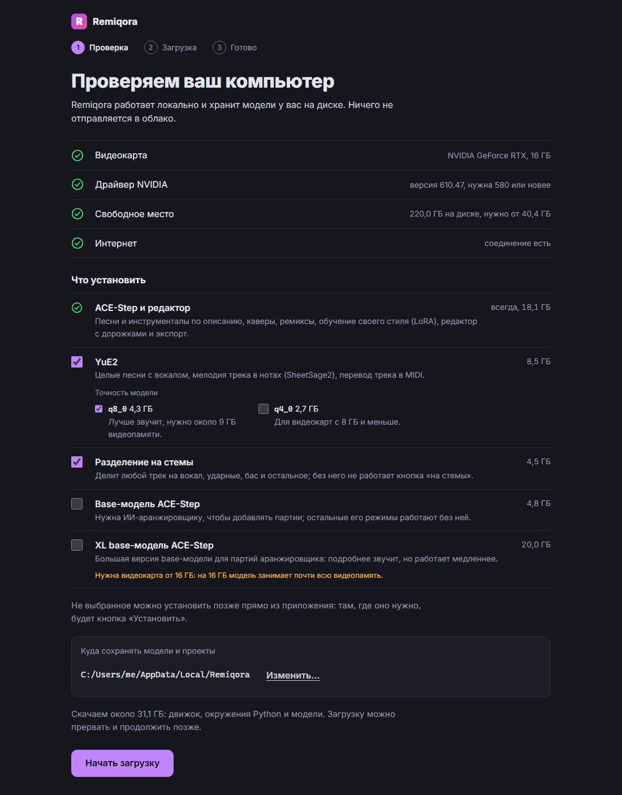
  
</p>

- **Первый запуск.** Приложение проверяет видеокарту, драйвер, свободное место и соединение, даёт выбрать одну папку для моделей и проектов и спрашивает, что установить. ACE-Step с редактором ставится всегда (около 18 ГБ: ACE-Step, его turbo-модель, FFmpeg и окружения Python). Остальное — галочки с размером:
  - **YuE2** (около 8,5 ГБ): движок audio.cpp (CUDA на Windows, Metal на macOS), YuE2, SheetSage2 и MuScriptor. Точность тоже выбирается: `q8_0` звучит лучше и требует около 9 ГБ видеопамяти, `q4_0` (2,7 ГБ) — для карт с 8 ГБ и меньше, на такой карте она выбрана по умолчанию;
  - **Разделение на стемы** (Demucs, около 4,5 ГБ);
  - **Stable Audio 3** (около 4,5 ГБ, выключен по умолчанию) — его окружение Python и отмеченные под ним модели (`medium` 10,4 ГБ, `small-music` и `small-sfx` по 3,5 ГБ; на Mac `medium` не предлагается). Веса закрыты лицензией на Hugging Face: примите лицензию на странице каждой модели, затем войдите в Hugging Face прямо с экрана установки (откроется браузер) или вставьте токен с ролью Read — установщик проверит доступ до начала загрузки. Вставленный токен хранится в папке с данными, а токен от входа через браузер живёт несколько часов и нужен только установщику. Не отмеченные модели и открытые base-чекпойнты можно скачать позже на странице «Модели»;
  - **Помощник промтов** (около 4 ГБ, выключен по умолчанию) для режима «Из идеи» — его окружение Python, по большей части общее с окружением Stable Audio 3, если выбраны оба. Модель (Qwen3.5-2B, около 4,6 ГБ) скачивается потом на странице «Модели»;
  - **base-модель ACE-Step** (около 4,8 ГБ) — для добавления партий ИИ-аранжировщиком;
  - **XL base-модель ACE-Step** (около 20 ГБ) — выключена по умолчанию, с предупреждением, если у видеокарты меньше 16 ГБ.

  Требуемое свободное место считается по выбранному. Всё, что не поставили, видно в приложении как «не установлено» с кнопкой **«Установить»**: она докачивает только эту часть, а приложение продолжает работать. Если процесс прервать, завершённые шаги пропускаются, а загрузки продолжаются с места остановки.
- **Дальше при каждом запуске.** Приложение поднимает сервер и открывает интерфейс. Закрытие окна останавливает серверы моделей и освобождает видеокарту.
- **Где что лежит.** Модели, база, сгенерированное аудио и логи остаются в выбранной папке, ничего никуда не отправляется. Папку нельзя перенести позже: база хранит абсолютные пути.

**Статус.** Экспериментально. Установщики пока не подписаны: Windows показывает предупреждение SmartScreen («Подробнее» → «Выполнить в любом случае»), а macOS сообщает, что не может проверить приложение: закройте это окно, откройте «Системные настройки → Конфиденциальность и безопасность», нажмите «Всё равно открыть» и подтвердите (нужно один раз). Если же macOS пишет, что приложение «повреждено и не может быть открыто» (сборка 0.2.1 и более ранние, [#33](https://github.com/inikolax/remiqora/issues/33)), перетащите его в «Программы» и выполните в Терминале `xattr -dr com.apple.quarantine /Applications/Remiqora.app`. Сумма SHA-256 каждого файла лежит в `SHA256SUMS.txt` на странице релиза. Чтобы собрать установщик самостоятельно:

```sh
cd frontend && npm ci && cd ../desktop && npm ci
npm run dist    # Windows: dist/Remiqora-Setup-<версия>.exe · macOS (запускать на Mac): dist/Remiqora-<версия>-arm64.dmg
```

В [`desktop/README.md`](desktop/README.md) описано, что ставит первый запуск, тестовые переключатели и известные пробелы.

**На чём оно построено.** Оболочка на [Electron](https://www.electronjs.org) вокруг того же веб-интерфейса и бэкенда на FastAPI, упакованная [electron-builder](https://www.electron.build) (установщик NSIS на Windows, DMG на macOS). Первый запуск использует [uv](https://docs.astral.sh/uv/) для окружений Python, релизные бинарники [audio.cpp](https://github.com/0xShug0/audio.cpp) и статические сборки FFmpeg. Лицензии не меняются; в частности, веса YuE2-3B остаются под CC BY-NC 4.0.

### Установка скриптами

Шаги ниже ставят Remiqora скриптами: нужны Git, терминал и, на Windows, инструменты сборки.

**На Windows — одним файлом:** дважды щёлкните `install.bat`. Он поставит недостающие инструменты (затем попросит открыть новое окно и запустить `install.bat` ещё раз), установит движки и предложит скачать base-модель ACE-Step для ИИ-аранжировщика. Запуск — `prod_run.bat` (для разработки — `dev.bat`). Скрипты говорят по-русски или по-английски: установка один раз спрашивает язык (по умолчанию — язык Windows), запуск помнит выбор; `REMIQORA_LANG=ru` или `en` задаёт язык явно, а если удалить `.remiqora-lang`, вопрос появится снова. Шаги 0 и 1 ниже — то, что выполняет `install.bat`.

### Шаг 0: инструменты сборки

```cmd
setup_prereqs.bat
```

Через `winget` (встроен в Windows 10/11) ставит Git, Python, `uv`, Node.js,
CMake, ffmpeg, а также Visual Studio Build Tools (C++ workload) и CUDA
Toolkit — это уже большие, требуют прав администратора и могут занять время.
`setup_prereqs.bat -SkipHeavy` ставит только маленькие быстрые тулы, а
Build Tools/CUDA — вручную по ссылкам, которые скрипт выведет.

**Драйвер NVIDIA GPU намеренно исключён из автоматической установки** — поставьте вручную с
[nvidia.com/drivers](https://www.nvidia.com/drivers) под свою карту: молча
подменять видеодрайвер на чужой машине рискованно (может уронить экран,
часто требует перезагрузки в удобный вам момент, а не скрипту).

После установки закройте терминал и откройте новый, чтобы PATH подхватил
свежепоставленные инструменты.

**На macOS (Apple Silicon):**
```sh
./setup_prereqs.sh
```
Через [Homebrew](https://brew.sh) ставит Git, Python, `uv`, Node.js, CMake,
ffmpeg и Ninja. Отдельного шага с GPU-драйвером нет: Metal встроен в macOS.
CMake/Ninja нужны только для пути `--from-source` ниже — установка YuE2 по
умолчанию вообще не требует компилятора.

### Шаг 1: движки генерации

```cmd
setup_models.bat
```

Скрипт:
1. Клонирует `ace-step/ACE-Step-1.5` (MIT) и `0xShug0/audio.cpp` (Apache-2.0,
   ветка `dev` — поддержка YuE2 пока только там) в `external/`.
2. Накатывает небольшой патч на ACE-Step (API отмены задач; audio.cpp патч
   не требуется, см. `external/patches/README.md`) — без кастомных web-ui из
   апстримов, они не нужны.
3. Запускает `uv sync` для ACE-Step и сборку `audiocpp_server` (CUDA-релиз,
   модели `yue2,sheetsage2,muscriptor`) для audio.cpp.
4. Настраивает `external/sa3-server` — наш HTTP-сервер вокруг Stable Audio 3 (`uv sync`;
   веса скачиваются только с `-StableAudioModels`, см. ниже).
5. Скачивает GGUF-веса YuE2/SheetSage2/MuScriptor (~10 ГБ) через
   `tools/model_manager_v2.py` из audio.cpp.
6. Поднимает uv-проект с `demucs` в `external/Demucs` для разделения на
   стемы, привязанный к индексу колёс PyTorch `cu128`, чтобы встала именно
   CUDA-сборка (простой `uv add demucs` тихо поставил бы CPU-версию torch).
7. Создаёт `backend/.env` с путями на только что склонированные репозитории,
   включая `FFMPEG_BIN_DIR` — путь определяется автоматически из
   winget-установки ffmpeg (`setup_prereqs.bat`), даже если она была
   поставлена в этом же терминале, до того как новый терминал подхватил бы
   её в PATH.

Веса самого ACE-Step отдельно скачивать не нужно — `acestep-api` тянет их
сам с HuggingFace/ModelScope при первом запросе, так же как это делает его
Gradio UI.

**Веса Stable Audio 3** скачиваются в приложении. На странице «Модели» (шестерёнка в шапке) — шесть чекпойнтов с размерами, кнопкой «Скачать» и прогрессом; скачивание можно остановить (готовые файлы сохраняются, недокачанный начнётся заново) и оно продолжается, пока вы на других страницах. `medium`, `small-music` и `small-sfx` закрыты на Hugging Face: войдите там, нажмите *Agree* на странице модели, создайте токен с правом *Read* и вставьте его на той же странице (он сохраняется в кэш Hugging Face, как после `hf auth login`). Чекпойнты `-base` открыты. Без приложения: `setup_models.bat -StableAudioModels small-sfx,medium` (macOS: `--stable-audio-models=small-music,small-sfx`, Linux: `STABLE_AUDIO_MODELS="medium small-sfx"`) или `python -m sa3_server.download medium` питоном из `external/sa3-server`.

Скрипт идемпотентен — его можно перезапускать (флаги `-SkipBuild` /
`-SkipWeights` пропускают соответствующие шаги). Для работы скрипта должны быть предварительно установлены:
`git`, [`uv`](https://docs.astral.sh/uv/getting-started/installation/), Python 3,
CMake, CUDA Toolkit и Visual Studio Build Tools (C++ workload) — при
отсутствии какого-то из них шаг просто пропускается с подсказкой, что
поставить.

После этого вручную остаётся только проверить `CUDA_BIN_DIR` в
`backend/.env` (`FFMPEG_BIN_DIR` подставляется сам — если только ffmpeg
вообще не нашёлся, тогда скрипт об этом явно предупредит, и путь придётся
указать руками).

Жёсткие требования к машине, которые скрипт снять не может: Windows,
NVIDIA GPU с поддержкой CUDA (тестировалось на RTX 4080 16 ГБ) и
установленный видеодрайвер.

**На macOS (Apple Silicon):**
```sh
./setup_models.sh
```
Адаптировано под macOS, с одним отличием от шагов Windows выше: по
умолчанию `audiocpp_server` устанавливается из готового **прекомпилированного
macOS/Metal релиза** audio.cpp (закреплённый тег, sha256 проверяется перед
распаковкой) — компилятор вообще не нужен, в отличие от Windows-пути,
который всегда собирает из исходников, поскольку готового CUDA-релиза не
существует. Uv-проект Demucs тоже не привязывается к CUDA-индексу колёс —
обычная зависимость `torch` и так резолвится в MPS-совместимое колесо на
darwin/arm64, точно так же, как в `pyproject.toml` самого ACE-Step-1.5. В
записанном `backend/.env` нет `CUDA_BIN_DIR` — CUDA Toolkit на этом пути
не нужен.

Флаг `--from-source` вместо скачивания релиза соберёт audio.cpp из того же
закреплённого коммита ветки `dev`, что использует Windows (пригодится, если
релиз отстал от фикса, который есть только в `dev`, либо на Intel Mac, для
которого готового бинарника нет) — для этого пути нужен полный **Xcode.app**
(не только Command Line Tools) из-за Metal-компилятора шейдеров;
`setup_prereqs.sh` выведет точные шаги, если его не хватает. `--skip-build` /
`--skip-weights` — аналоги `-SkipBuild` / `-SkipWeights`. В остальном скрипт
ожидает, что `git`, `uv` и Python 3 уже установлены (а для `--from-source`
ещё и `cmake`).

Жёсткие требования к машине на пути по умолчанию (готовый бинарник): macOS,
Apple Silicon (чип серии M) — для Intel нужен `--from-source`. Проверено на
MacBook Air, Apple M5, 24 ГБ RAM — включая прогон с абсолютно чистого
состояния (без единого brew-пакета и файлов проекта) до генерации
аудио через YuE2 на Metal-бэкенде.
Этот путь новее и меньше обкатан, чем Windows/CUDA — ожидайте, что будет медленнее
(Metal вместо CUDA). Именно `--from-source` может периодически требовать
ручной подстройки (сдвинуть закреплённый коммит), если ветка `dev` audio.cpp
уйдёт вперёд; путь с готовым релизом закреплён на фиксированном теге и сам
по себе не «уезжает».

**На Linux (NVIDIA CUDA):**
```sh
./setup_linux.sh
```
Собирает audio.cpp с нативным Linux CUDA-бэкендом, ставит ACE-Step и Demucs в изолированные окружения, скачивает веса моделей и записывает `backend/.env`. Скрипту нужны git, Python 3.11/3.12, uv, Node.js 20.19+ (или 22.12+), npm, CMake, ffmpeg и CUDA toolkit с nvcc и dev-заголовками cuBLAS/cuFFT. Видеодрайвер NVIDIA сознательно не устанавливается и не трогается.

Пути к инструментам переопределяются (`UV_BIN`, `NODE_BIN`, `NPM_BIN`, `CMAKE_BIN`, `NVCC_BIN`, `CUDA_TOOLKIT_PREFIX`, `CUDA_LIB_DIR`); `STABLE_AUDIO_MODELS="medium small-sfx"` заодно скачивает эти чекпойнты Stable Audio 3. На многокарточных хостах `ACE_STEP_DEVICE=0 YUE2_DEVICE=1 ./setup_linux.sh` закрепляет движки за разными GPU и включает одновременную резидентность моделей, если оба значения устройств заданы явно и различаются; если оставить любое из них пустым (или задать оба одинаковыми) — сохраняется взаимоисключающее переключение по умолчанию.

Поддержка Linux сделана силами сообщества (контрибьютор [Spankie0001](https://github.com/Spankie0001)): проверена мной end-to-end на Ubuntu 24.04 через WSL2 с проброшенной GPU (RTX 4080, CUDA 13.3) — сборка, оба движка с реальной генерацией, переключение оркестратора в обе стороны и чистое завершение процессов без утечки GPU-памяти. Не проверялось: другие дистрибутивы, голое железо, AMD/Vulkan, Demucs и MuScriptor.

### Шаг 2: запуск

```cmd
dev.bat
```
Поднимает бэкенд (порт 9000) и фронтенд с Hot Module Replacement (Vite, порт 5173), сам создаёт `backend/.venv` и `frontend/node_modules` при первом запуске, открывает браузер на [http://localhost:5173](http://localhost:5173).

Для боевого режима — сборка SPA и раздача с одного порта:
```cmd
prod_run.bat
```
Собирает клиент через `npm run build` и раздаёт готовый SPA-дистрибутив вместе с API на [http://127.0.0.1:9000](http://127.0.0.1:9000).

Uv-проект `demucs` для разделения на стемы поднимает сам `setup_models.bat` (см. выше); веса `htdemucs` скачиваются отдельно и сами при первом использовании.

**На Linux:** `./prod_run_linux.sh` собирает фронтенд и раздаёт SPA вместе с API на `127.0.0.1:9000` по умолчанию. Переопределяется через `REMIQORA_HOST` / `REMIQORA_PORT`. Чтобы разрешить доступ из локальной сети, запустите `REMIQORA_HOST=0.0.0.0 ./prod_run_linux.sh`; у Remiqora нет встроенной авторизации, поэтому открывайте её только в доверенной сети или за прокси с авторизацией.

**На macOS:** аналоги — `./dev.sh` и `./prod_run.sh`, ведут себя так же, только
бэкенд и фронтенд запускаются как фоновые задачи самого скрипта (остановить
оба — Ctrl+C), а не в отдельных окнах терминала.

---

## ⚙ Конфигурация (.env)

Настройки хранятся в файле `backend/.env` (шаблон — `backend/.env.example`,
`setup_models.bat` создаёт его автоматически с путями на клонированные репозитории):
```ini
ACE_STEP_DIR=E:\AI\ACE\ACE-Step-1.5
YUE2_DIR=E:\AI\YuE2-3B
DEMUCS_DIR=E:\AI\Demucs
STABLE_AUDIO_DIR=E:\AI\StableAudio
FFMPEG_BIN_DIR=E:\AI\ACE\tools\ffmpeg-shared\ffmpeg-master-latest-win64-gpl-shared\bin
CUDA_BIN_DIR=C:\Program Files\NVIDIA GPU Computing Toolkit\CUDA\v13.4\bin
```

- `ACE_STEP_DIR` — корень склонированного и запатченного ACE-Step-1.5.
- `YUE2_DIR` — корень склонированного и запатченного audio.cpp (там же собран `audiocpp_server.exe` и лежат GGUF-веса YuE2/SheetSage2/MuScriptor).
- `DEMUCS_DIR` — корень uv-проекта с `demucs`, используемого для разделения на стемы.
- `STABLE_AUDIO_DIR` — корень uv-проекта `sa3-server` (копия `external/sa3-server` со своим `.venv`). Веса Stable Audio 3 читаются из кэша Hugging Face (`HF_HOME`) и скачиваются на странице Stable Audio 3 в приложении (см. «Веса Stable Audio 3» выше); основные чекпойнты закрыты, поэтому сначала примите лицензию на [`stabilityai/stable-audio-3-medium`](https://huggingface.co/stabilityai/stable-audio-3-medium) (и `-small-music` / `-small-sfx`). Необязательные: `STABLE_AUDIO_API_PORT` (8002), `STABLE_AUDIO_PRELOAD` (какой чекпойнт прогревать при старте, по умолчанию `medium`), `STABLE_AUDIO_DEVICE`.
- `FFMPEG_BIN_DIR` — папка с `ffmpeg.exe`/`ffprobe.exe`.
- `CUDA_BIN_DIR` — папка `bin` установленного CUDA Toolkit (нужна в PATH для `audiocpp_server.exe`). Только для Windows — на macOS остаётся пустым, там YuE2 работает через Metal-бэкенд.

---

## Известные ограничения

- Интерфейс и установщик переведены машинно на 18 языков (русский и английский написаны вручную); носители языка их не вычитывали. Тексты ассистента на редких языках не лучше модели 2B, которая их пишет.
- Движки (ACE-Step, YuE2, Stable Audio 3) по умолчанию переключаются взаимоисключающе. На многокарточных Linux-хостах явное указание всех `*_DEVICE` (`ACE_STEP_DEVICE`, `YUE2_DEVICE`, `STABLE_AUDIO_DEVICE`) с разными значениями включает одновременную резидентность и закрепляет каждый движок за своей GPU.
- Stable Audio 3 делает только инструментал (без вокала), до 380 с за задачу на модели medium, а чекпойнт `medium` требует CUDA-карту с Flash Attention (готовые колёса закреплены для Windows и Linux; на macOS работают только small-модели). Партию поверх микса он не пишет: «Добавить партию» в аранжировщике остаётся за ACE-Step. Основные чекпойнты закрыты: чтобы их скачать, нужны бесплатный аккаунт Hugging Face, один раз принятая лицензия и токен.
- Транскрипция в MIDI требует активной именно YuE2 (модель MuScriptor подгружается в её процесс).
- Windows (NVIDIA CUDA), macOS/Apple Silicon (Metal/MPS) и Linux x86_64 (NVIDIA CUDA) имеют пути установки и запуска — под первую написаны `.bat`/`.ps1`, под остальные две — `.sh`. Поддержка Linux сделана силами сообщества: собирает audio.cpp из исходников и требует CUDA-тулкит помимо драйвера, проверена end-to-end на Ubuntu 24.04 (через WSL2 с проброшенной GPU), а не на голом железе или других дистрибутивах.
- Установщики настольного приложения экспериментальные: без подписи (запрос SmartScreen или Gatekeeper), а первый запуск скачивает от 18 ГБ (только ACE-Step) до 80 ГБ (всё, включая XL-модель, Stable Audio 3 и помощника промтов с их моделями). Установщик пока не поддерживает Linux — на Linux нужно запускать из исходников через `setup_linux.sh`.
- Путь macOS/Metal новее и меньше обкатан, чем Windows/CUDA — ожидайте, что будет медленнее. По умолчанию он ставит YuE2 из готового релиза с закреплённым тегом (компилятор не нужен); `--from-source` собирает тот же коммит `dev`, что и Windows, и может изредка требовать сдвинуть этот пин, если `dev` уйдёт вперёд.
